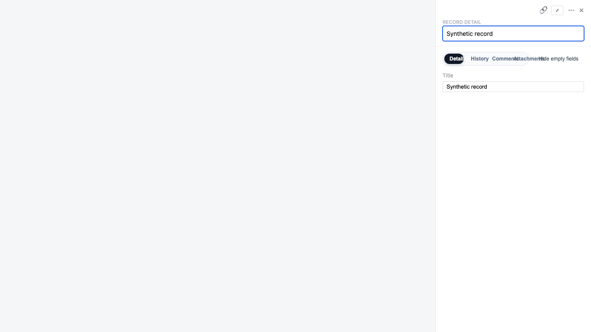
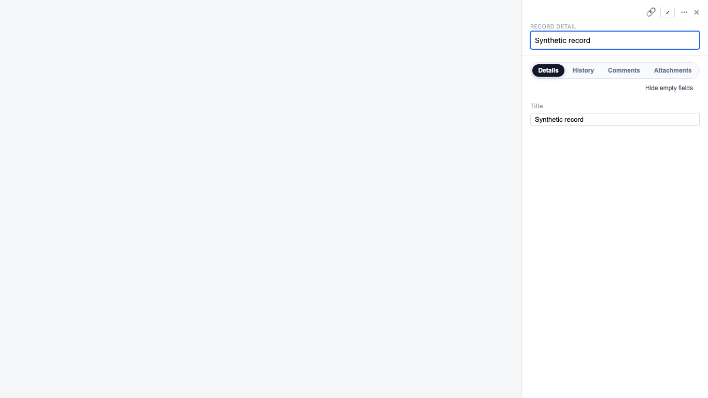

# Record inspector narrow-tab repair

Date: 2026-10-27 (Asia/Taipei).

At a 360px record-inspector width, the English tab labels overlap each other and the hide-empty control. The repair gives the tab pill its own row below the 420px container breakpoint, lets tab widths follow their labels, and uses compact padding. Smaller mobile overlays retain wrapping; wider panels retain the existing inline layout.

This is a standalone repair of the shipped inspector. The older Record Detail/W2 goal remains paused.

## Source binding

- Main verified through GitHub before publication: `5b9ec081bba822c6c4f4668552c274ecc906a7e4`.
- Product and test commit: `6c7e1ad90c168fdb8b37530591be6531dcc5af04`, directly based on that main.
- This evidence-only follow-up changes no product, harness, test, dependency, workflow or configuration file.
- Product file SHA256: `6eeb0638afc5bb11d82c3bf1ad1ac149cead928f6ba53402dfbec667afa35f7f`.

## Local verification

The following checks were refreshed on the product/test commit above with independent local dependency directories:

| Check | Result |
| --- | --- |
| Chromium: `pnpm --filter @metasheet/web exec playwright test --config playwright.verification.config.ts record-inspector-tabs.spec.ts --retries=0` (CI mode) | 30 passed; zero failures, skips or flaky results |
| Vitest: `multitable-record-inspector-header.spec.ts`, `multitable-record-inspector-resize.spec.ts`, `multitable-record-inspector.spec.ts` | 3 files, 119 passed |
| `pnpm validate:all` | Passed: plugin manifests, workspace lint and type checking |
| Scoped ESLint on the changed Vue/TypeScript files | Zero errors; 17 existing Vue prop-default warnings |
| `git diff --check` | Passed |

Browser coverage uses the real component and application styles with synthetic props: English/Chinese; three desktop viewport sizes at panel widths 360/560/720; mobile viewports 390/375/360/320; container widths 419/420. Assertions measure actual text bounds, wrap placement, overflow, tab keyboard navigation and the hide-empty toggle.

The existing `Multitable Browser Verify` workflow collects this spec, and its pull-request paths include both the inspector and verification directory. Remote CI is separate from these local results.

Earlier same-code controls were retained rather than rerun: the base layout failed at 360 while 560/720 passed; removing either the full-row allocation or compact padding made the 360 browser leg fail while both wider controls passed. The five product/test file hashes still matched their recorded candidate manifest before this evidence commit. These two mutations do not establish exhaustive CSS regression coverage.

## Synthetic screenshots

Both screenshots use an English 1366px viewport and a 360px panel. The before image is the retained base-layout control; the after image is from the refreshed 30-case run above. Neither contains customer data.

Before:

After:

## Limits and rollback

This evidence covers the layout repair and nearby interactions. It does not establish backend integration, tenant authorization, screen-reader acceptance, or completion of the older W2 goal. The full shared browser lane is left to remote CI; only the new 30-case spec was rerun locally.

The repair has no migration, backend API change, dependency change or feature-flag change. A later authorized rollback can revert the standalone repair and accompanying tests. This submission authorizes neither merge nor deployment nor feature enablement.
