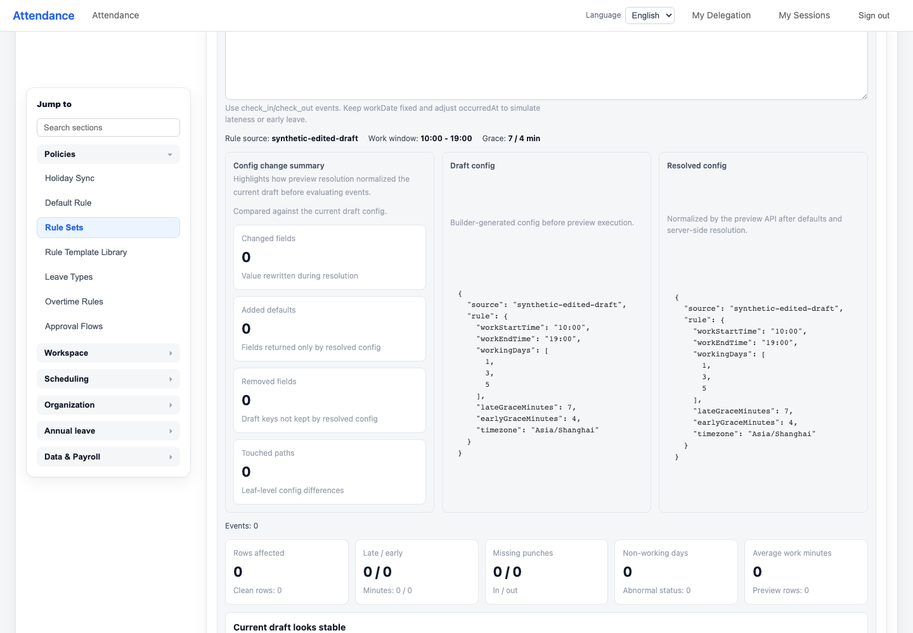
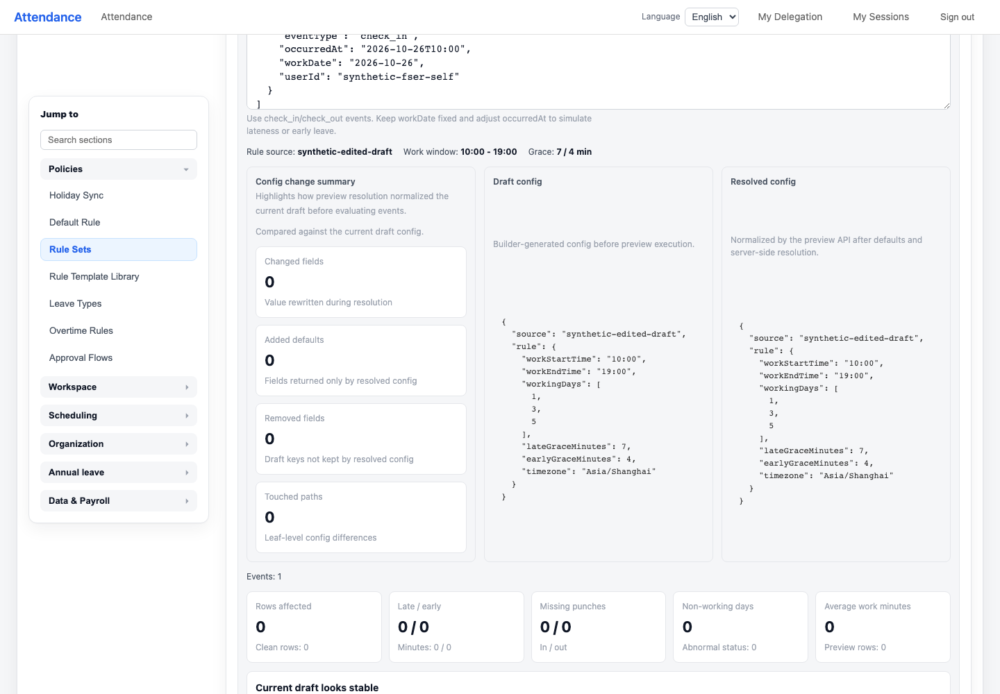

# Rule editor current-draft preview verification — 2026-10-26

Status: local-qualified Draft/HOLD; current public-head required CI pending.

When an administrator edits an existing rule set, the editor previously sent both
the displayed draft config and its saved ID. The existing API intentionally reloads
stored config for an ID, so the preview silently used the saved version. This patch
removes only that selector from this editor call; explicit API saved-ID preview,
sample-event parser, permissions, editing metadata and Save/Update remain unchanged.

## Reproduction and correction

The actual registered plugin route over local HTTP, injected synthetic principal
and mocked SQL confirmed config-only / ID-only controls and saved-ID precedence.
It does not prove real DB/JWT authorization. The mounted original UI produced
2 matching failures and 1 new-unsaved control pass.

The corrected mounted cases passed across phases: 2 initial passes plus the affected
sample-events case after fixing the fixture's expectation of existing local-time
normalization (2 filtered exclusions). Restoring only the old ID block yielded
2 matching failures and 1 control pass; exact candidate bytes were restored.

## Actual local commands

All ran in the independent copy with Node20.20.2/pnpm9.15.9 and empty environment.

- New regression: pnpm --filter @metasheet/web exec vitest run tests/attendance-rule-draft-preview.spec.ts (phase-bound3unique, not a fresh all3 claim).
- Affected event case: same command with -t 'preserves sample events':1passed/2filtered.
- Registration neighbors: run-required-web-tests-shape.spec.ts and attendance-web-guard-workflow.spec.ts:36passed.
- Existing attendance-admin-regressions.spec.ts:146passed, zero skips.
- New spec ESLint:0; official token manifest write/check and bash -n:0.
- pnpm validate:all:0; pnpm --filter @metasheet/web build:0.
- Full AttendanceView lint via identical stdin filename: base17/current17 diagnostics; introduced0, not full-file-clean.
- Independent Sol/high source review: no confirmed introduced P1/P2. It did not execute validation.

## Native actual-entry evidence

The actual main.ts/router/AttendanceView chain used only synthetic strict API mocks.
Native Tab/type/Enter preview passed before a later textarea-format oracle failure.
Only the remaining Space-with-events branch retried, using structural JSON equality
after the existing formatter. Each phase issued1readonly preview POST carrying the
current visible config without saved-ID; resolved config matched the current draft.
Update mode remained visible, no Save/Update requests,0external requests/0pageerrors.
Owned servers were stopped and ports closed. Screenshots were visually reviewed.

See [machine-readable receipts and SHA256](../../artifacts/attendance-rule-draft-preview-20261026/verification.json).
Original red/log-postcheck, initial UTC-fixture and native JSON-format failures are
retained. No budgets, production parser, writer or API guard were weakened.

No fresh PG/provider/writer acceptance, human assistive-technology or full parent
acceptance is claimed. All PRs stay Draft/HOLD; no merge/deploy/config/R71/tag/release
changes. Stream/lifecycle OFF; real UAT/business50004 excluded; historical08PUT
remains INCONCLUSIVE.
