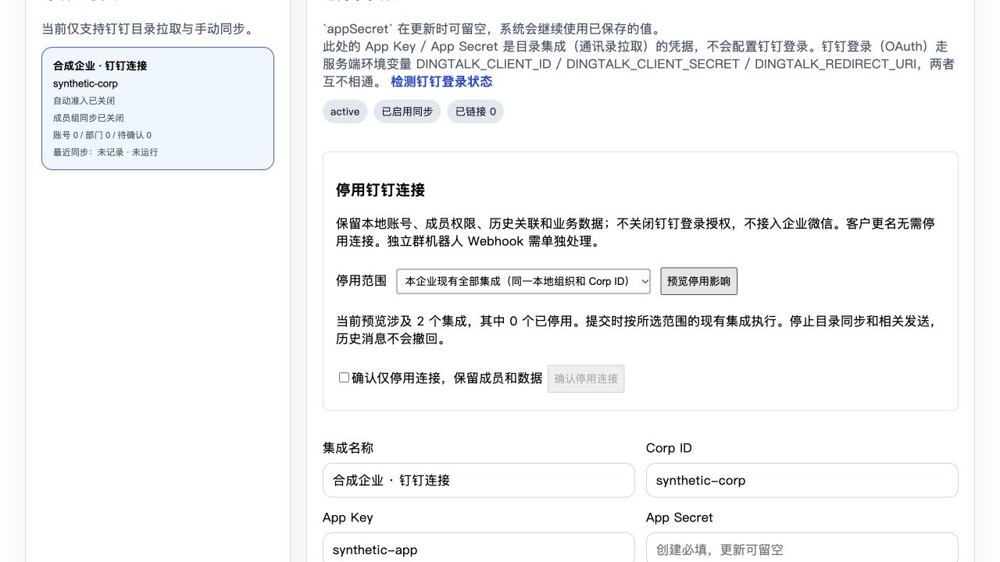
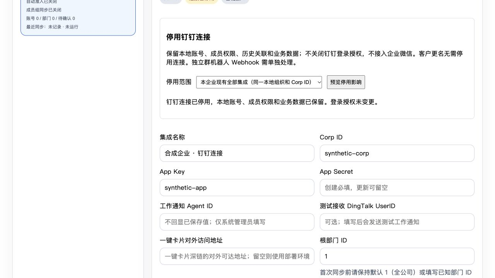

# 钉钉企业／集成停用验证 — 2026-10-29

## 交付与范围

基线 `a03d804d60d83717feaedce099e5ff14216afc58`，分支 `codex/dingtalk-integration-disable-20261029`。修复代码冻结在 `bf34d6f0ca`，已普通合入 #6640 的 `71e60292ad`，没有 rebase 或强推。本次交付停用代码、回归测试和 Draft PR；没有修改在线配置、真实解绑、密文、账号关联或登录授权，没有合并或部署。

[设计锁](dingtalk-connection-disable-design-lock-20261029.md)明确：客户更名保留企业身份，只改显示名称；换用企业微信需要另行迁移。本功能停止目录中登记的钉钉企业应用连接，保留本地账号、组织、目录镜像、业务数据、成员关系、权限和登录授权。

**范围限制：独立群机器人 Webhook 没有目录集成／企业归属，本次不会自动关闭。此功能不能作为全部钉钉出口的总开关；客户迁出钉钉前必须另行盘点这些自动化。**

## 行为与保护

- 管理员在目录同步页选择当前集成，或同一本地组织＋Corp ID 下全部钉钉集成；先只读预览，再勾选确认。预览是快照，执行范围以提交时的现有集成为准。
- 用独立 JSON 停用标记，关闭自动同步；保持原 `status`，避免把企业连接停用误作成员停权。没有新增迁移或环境开关。
- 手动／异步／预览同步入口拒绝停用连接，在同步落库的 source-freeze 锁下复查。调度器不再登记停用连接。
- 注册应用的工作通知、动作卡片、交互卡片及待办写操作在真正 HTTP 调用前检查状态，并持锁至请求完成。停用等待已有请求结束；等待超时返回冲突，不能报告成功。已发送消息不能撤回。
- 应用跨选定范围共享时，停用拒绝并保持原状。停用后不接受新建集成或修改另一条集成的应用标识来复用已停用应用。普通保存原子保留停用标记及 `sync_enabled=false`，旧配置保存不能抹去停用。
- 若存在停用连接，缺少归属或未登记应用的发送请求拒绝；其他已登记且正常的组织继续工作。数据库状态不可读时，发送在出站前失败。
- OAuth／容器登录流程不受此标记控制。新到达的停用集成交互卡片回调拒绝；已经进入审批处理的请求不会被取消，本地审批入口及权限保持不变。
- UI 展示“连接已停用（成员权限保留）”，禁用同步及连接发送测试。网络中断或提交结果不明确时要求刷新核对，不自动重试停用。

## Mac mini 隔离验证

Node **20.20.2**、pnpm **10.16.1**、PostgreSQL **16**。使用本任务独占数据库实例、随机 schema、合成账号／成员／业务记录和假发送器；没有访问真实钉钉 API或修改 staging。真实数据库套件建的是最小合成 schema，不代表目标环境迁移／升级验收。

| 验证 | 最终结果 |
| --- | --- |
| 后端定向及邻接单元回归 | 33 文件，**1,460 通过** |
| 真实 PostgreSQL 停用／隔离／并发测试 | 1 文件，**11 通过** |
| Vue 目录页面及选项组件回归 | 2 文件，**116 通过** |
| `pnpm validate:all` | **退出码 0**：插件验证、lint、类型检查 |
| 停用核心覆盖率 | **98.84% 行／语句，100% 函数，89.87% 分支** |
| 新增来源守卫变异 | 移除来源后 **3 失败／3 通过**；恢复后 **6/6 通过**，源码字节恢复 |
| 提交文件与受测文件一致性 | **41 个源码／测试／工作流文件 SHA-256 一致** |
| `git diff --check` | 通过 |

覆盖率为核心守卫单元 27 项＋真实 PG 11 项的组合；27 项已计入后端 1,460 项，不重复计数。未覆盖的两行是检测目标集合改变后拒绝提交的分支，不代表已穷尽竞态。

真实 PG 测试覆盖：单集成及企业范围、跨组织正常发送正例、跨范围共享应用拒绝、在途发送结束后才确认停用、排队发送在停用后拒绝、旧配置竞态、普通保存保留停用标记与企业名称、省略／改名语义、禁止其他集成接入已停用应用、三方交错中旧表单 AppKey CAS、未登记应用拒绝、同步落库复查及本地数据指纹保留。

Astra ultra 初审的 2 P1、1 P2 均补了红例：全局凭据绕过来源、HTTP 成功后 COMMIT 失败、普通保存三方竞态，以及真实卡片／待办账本调用链的不可重发语义，共 5 个失败在修复后通过。复审进一步补齐审批卡片终态更新与工作通知测试 API 的来源；新增六项出口用例包含停用来源零 HTTP 和正常来源可发送正例。网页终态用例使用构造的已提交 outcome，证明 hook 不改变本地结果，不冒充完整审批引擎／路由提交演练。

新增变异移除来源标识时，六项出口测试有三项失败，恢复后全部通过。`mutation-results.json` 中原五项来自旧 head `73953baa53`，本轮没有把历史结果冒充冻结 head 的重跑结果。原传输夹具仍可隔离守卫；新增核心、出口、卡片与待办故障用例使用真实 client／guard，仅替换 PG 与 HTTP。

完整测试文件清单和结果见 [validation-results.json](../../artifacts/dingtalk-connection-disable/validation-results.json)，覆盖率见 [coverage-summary.json](../../artifacts/dingtalk-connection-disable/coverage-summary.json)，负例结果见 [mutation-results.json](../../artifacts/dingtalk-connection-disable/mutation-results.json)，受测文件指纹见 [tested-source-sha256.json](../../artifacts/dingtalk-connection-disable/tested-source-sha256.json)。原始运行日志保留在本任务隔离目录，没有作为公开证据上传。

复现命令（后端文件清单见上述 JSON 的 `backendUnit.files`）：

```sh
pnpm --filter @metasheet/core-backend exec vitest run <backendUnit.files 中的完整清单> --reporter=dot
DATABASE_URL=<隔离测试库> pnpm --filter @metasheet/core-backend exec vitest run --config vitest.integration.config.ts tests/integration/directory-connection-disable.realdb.test.ts
pnpm --filter @metasheet/web exec vitest run tests/directoryManagementView.spec.ts tests/directoryConfigPickers.spec.ts --watch=false
pnpm validate:all
```

## 合成界面验收

浏览器加载真实 `DirectoryManagementView` 和停用组件，API由合成内存数据模拟：企业范围预览显示两个集成；勾选前确认按钮不可点；成功后显示停用标记，手动／异步／预览同步及测试按钮禁用，自动同步勾选禁用。合成界面操作没有调用在线停用接口。





## 独立复审

使用 `gpt-6-astra`、effort `ultra` 的独立只读代理，最终冻结核对 `bf34d6f0ca43aa4bf7ef0828897c3bb5ffc81eec`。结论：未发现新的可行动 findings；原 2 P1、1 P2 及后续两条来源遗漏均已封口。审阅覆盖真实发送调用链、缺失来源时拒绝、COMMIT 故障语义、AppKey CAS 及名称／停用组合。

复审代理没有执行测试，其结论不替代上述 Mac mini 实跑或最终 CI；文档／证据后续提交不修改这些受测源码，其 SHA-256 清单记录在产物中。

## CI、发布及恢复边界

新增真实 PG 套件接入 `plugin-tests.yml` Node 20 job，按整文件执行且缺少数据库必须失败；无 DB 默认任务排除该套件。Draft PR 创建后由 CI执行，本 MD 不把 Mac mini 通过等同于 13 项必需 CI 全绿。

旧 head `73953baa53` 的 Node 20 CI 因写路由登记及五个租约夹具失败，真实 PG 步骤未执行。本轮已补齐写路由清单与对应非管理员行为断言，修正租约／企业名称组合夹具、来源配置精确断言；这些夹具修复与运行时问题分别验证。

本分支已包含 #6640 展示代码；企业名称与停用标记同时保存／展示、旧配置省略语义和加载错误态纳入组合回归。staging 在线状态独立处理，没有因此执行线上停用或认定线上已升级。

本切片不提供恢复、删除或真实解绑接口。旧版本代码不会识别停用标记，因此**不能直接降级旧版本或清除标记来恢复**；如需降级，必须先另批并验证发送隔离与调度停止方案。数据保留并不等于旧版本仍能维持停用保护。

后续必须分别审批：登录授权处理、企业微信接入、真实解绑、在线配置修改、合并、部署和启用。全部群机器人出口盘点及真实目标环境验收仍是另一步。
