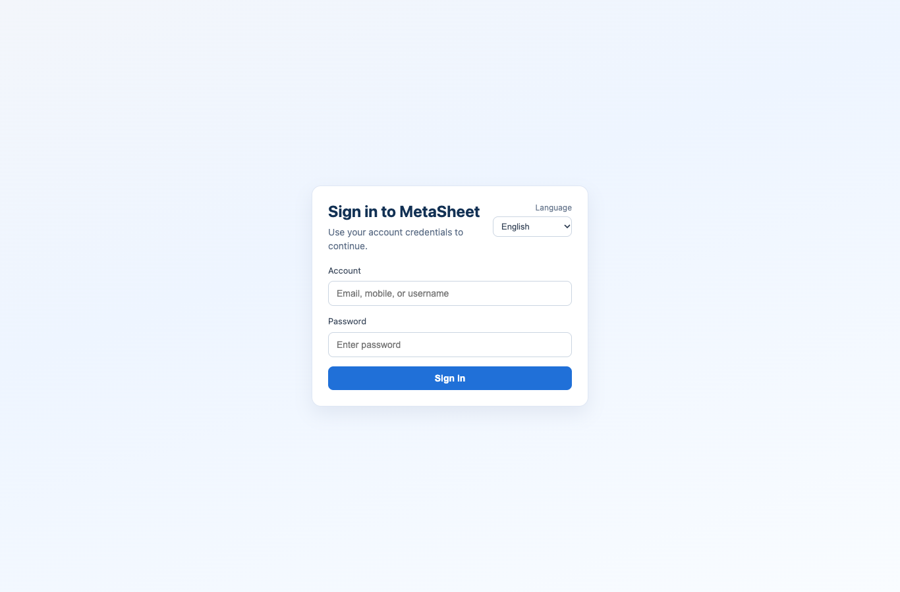
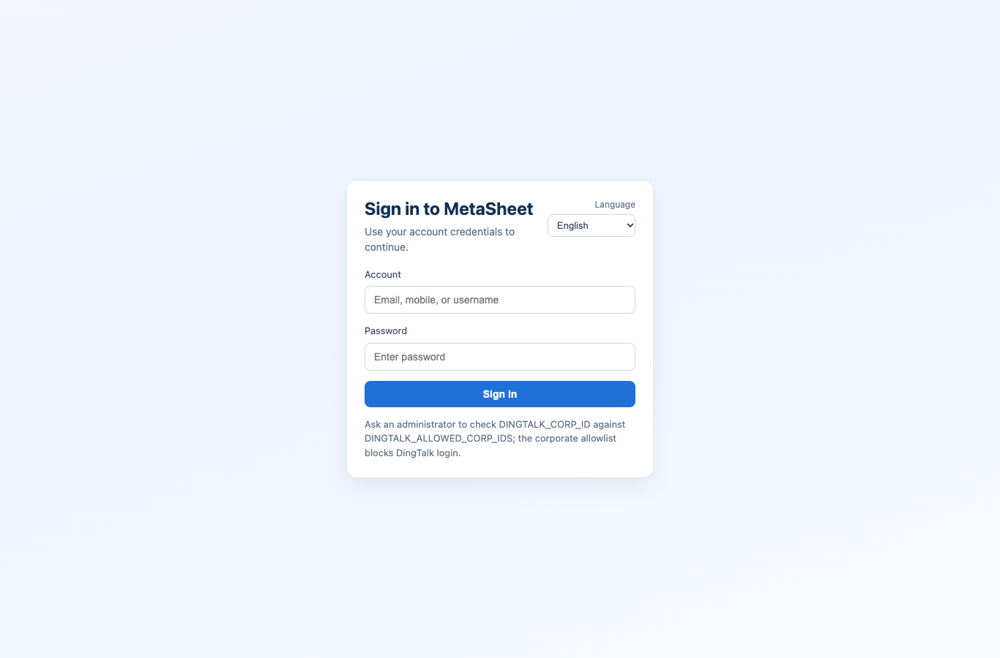
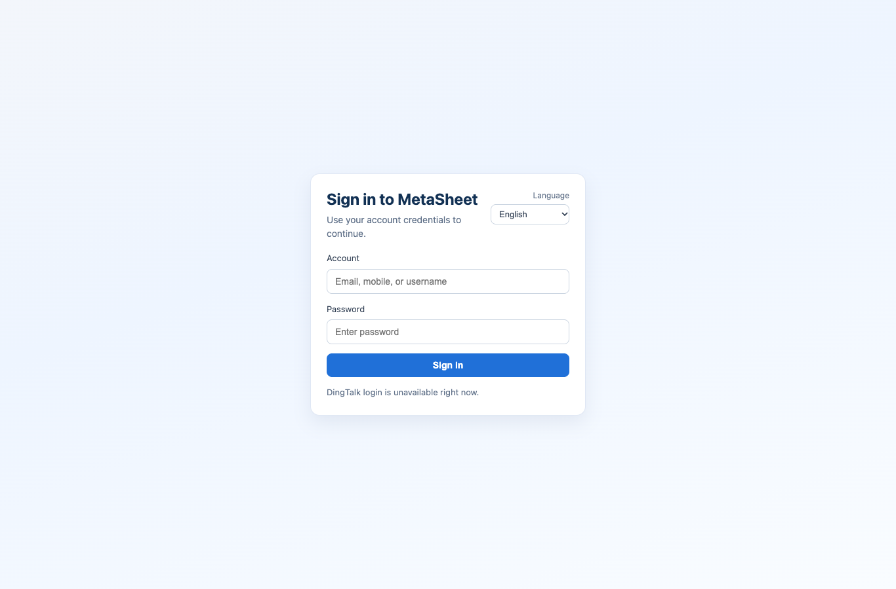
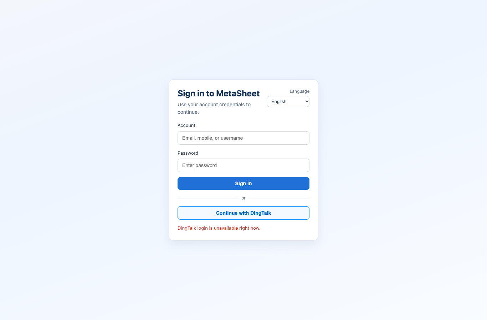

# DingTalk unconfigured login hint — Draft scope and verification

When the login probe explicitly reports `configured: false`, the public login page now omits administrator OAuth configuration guidance. The existing button/divider availability rules stay unchanged. Users can continue with password login.

The suppression is strictly `configured === false`. Configured-but-unavailable, corporate allowlist denial, unknown configuration state, HTTP/network/JSON probe failure, and an active login launch failure retain their existing messages. Password submission and container auto-login code are unchanged. Backend auth, permissions, configuration, provider writes and flags are unchanged.

| Gate | Evidence / result |
| --- | --- |
| Matching before failure | Old runtime: 4 matching hint failures and 9 controls; initial SSH filter broadened selection, other files excluded. |
| LoginView behavior | Whole file 34 actual passes, then 2 added standalone-message controls passed with 34 filtered. 36 unique cases covered in phases, not a fresh whole 36 run. |
| Unknown/error preservation | Deliberately broadening to `!configured`: 6 matching failures and 2 controls; exact restoration: 8 passes / 26 filtered. |
| Quality | Explicit changed-file ESLint: zero diagnostics; web type/build and `pnpm validate:all`: exit 0. Supplemental test-only edit separately linted; previous 34 test bodies and production source unchanged. |
| Browser | Actual built main SPA, synthetic probe responses: 5 scenarios passed, zero unknown requests, business writes or page errors. No real OAuth/provider/backend authentication. |
| Independent source review | No confirmed P1/P2; two standalone unknown-state controls added after the review's nonblocking coverage observation. |
| CI registration | Existing LoginView registration in attendance web guard and required web runner retained. Current PR CI must be verified independently. |
| R75 maintenance input | Exact base `2cda91b1736e87ab67b104db7405cf237c34a1b3`; two-file patch apply check, exact source readback and clean maintenance commit. Baseline component/spec/config/package/lock match main. No R75 image/build/deployment claimed. |
| Release boundary | Draft only. No merge, deployment, tag, Release, R71 or R77 package change. |

## Commands

- `pnpm --filter @metasheet/web exec vitest run --watch=false tests/LoginView.spec.ts`
- `pnpm --filter @metasheet/web exec vitest run --watch=false tests/LoginView.spec.ts -t 'retains the standalone'`
- `pnpm --filter @metasheet/web exec eslint src/views/LoginView.vue tests/LoginView.spec.ts`
- `pnpm --filter @metasheet/web build`
- `pnpm validate:all`

## Screenshots

Unconfigured desktop and mobile:

Retained allowlist and error messages:

## R75 operation and rollback

Apply only the supplied maintenance patch to a clean checkout at its exact base, build a new uniquely named test artifact and validate it in the separately authorized test environment. Do not overwrite an existing Release asset or edit compiled/minified JavaScript. The source patch has no migrations or dependencies. Roll back by rebuilding the original exact base or reverting the maintenance commit; runtime deployment remains the operator's separate action.
