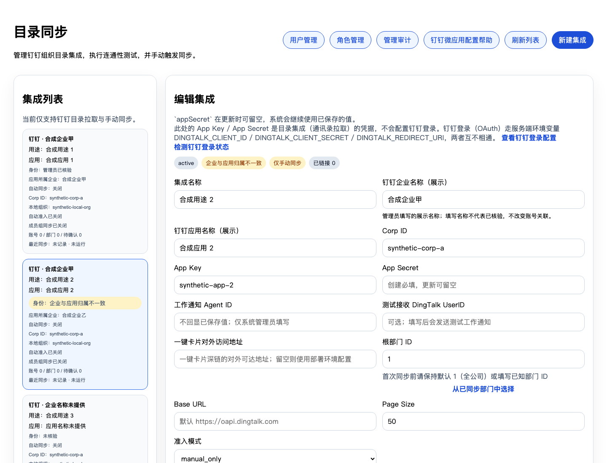
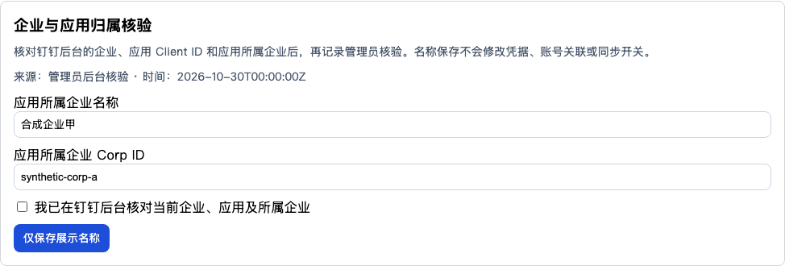

# 目录企业与应用身份展示：设计及验证

范围：扩展 Draft PR #6640，复用列表错误态修复及企业显示名；不合入 #6642 的连接停用实现。不改钉钉权限、OAuth、账号关联或在线配置，不执行同步、发送、合并或部署。所有开发和测试在本机；未启动 Mac mini 任务。

## 实现

- 列表以企业名称为主，分别显示应用名称、用途、应用所属企业、身份核验状态和自动同步状态。没有信息时明确显示未提供/未核验；已有名字不会自动变成已核验。
- 复用 JSONB config 的 corpName，新增可选 appName 和 identityVerification，不新增迁移或环境开关。旧数据不回填，未核验记录继续未核验。
- identityVerification 记录后台人工核对的完整企业、应用、应用所属企业标识、名称以及服务端时间/管理员。它是展示证据，不作为登录、同步、成员权限或发送授权。
- 状态由服务端计算：无有效证据为 unverified；完整目标企业标识与已确认应用所属企业标识相同为 verified，不同为 mismatch。不能以名称相同或取得 token 代替企业归属核验；来源明确标为管理员后台核验。
- 企业/应用标识或名称改变、正常编辑轮换凭据或改变 API origin 后，旧证据失效。无关设置保存保留有效证据；畸形、过期绑定或缺字段的证据按未核验处理，不拖垮列表。这里的失效指身份绑定变化，不引入时间过期策略。
- 新增平台管理员专用 `PUT /api/admin/directory/integrations/:integrationId/identity`，只接受身份标识快照、两个展示名、明确 boolean 确认以及应用所属企业信息。时间与操作人不接受客户端传入；不接受凭据、同步、角色等字段。
- 元数据保存只合并三个 config 键，并以完整原配置和企业标识作并发比较；普通配置保存也增加原配置比较，防止覆盖并发核验或把旧证据套到新凭据。冲突返回 409，无自动重试。
- 页面独立“仅保存展示名称 / 保存并记录管理员核验”按钮，不重存凭据、同步或成员规则；有未保存的身份/凭据变化时阻止核验，确认动作需要管理员主动勾选。

人工核验结论依赖管理员实际在钉钉后台完成检查，不是钉钉自动认证或法律主体认证。名称更改不构成企业切换。后台或凭据修复工具直接改写 config 时，也必须显式清除旧核验证据；本次不修改这些运维工具。

## 本机验证

Node 20.20.2，使用既有本机依赖，不连接 Mac mini：

- 新增后端身份回归首次运行 32 项失败，证明原行为不具备本功能；实现后身份/原企业名回归 43 项通过。
- 目录相关后端回归：37 文件，961 项通过，包含管理员权限、错误脱敏清单、身份状态、并发拒绝、凭据变更失效和企业不可变保护。
- 前端主页面及核验面板：2 文件，99 项通过，覆盖只读加载、名称不自动核验、三种状态、明确确认、元数据限定请求、409 不重试及未保存凭据阻断。
- 后端 `tsc --noEmit` 通过；前端应用 `vue-tsc -p tsconfig.app.json --noEmit` 通过。
- 本机完整 `vue-tsc -b` 的 node 配置阶段遇到共享依赖中 Vite 5/7 类型冲突；同一错误也在未修改的本机基线配置中复现。未通过放宽类型检查或修改 Vite 配置绕过。CI 使用干净依赖的结果单独登记。

新增前端面板及测试、后端身份解析模块的定向 ESLint 通过。公开材料仅包含合成标识；真实企业/应用标识、凭据和人员资料未提交。

合成浏览器验收通过：三种身份状态、名称不自动核验、明确确认后只发送元数据、未保存凭据阻断；无页面异常、无意外请求、未接触在线环境。

最终 CI 回执在本地验证材料目录中；最终结果以当前 head 的 CI 为准，旧 head 全绿不能代替本轮结果。

## E4 只读依赖核对（2026-10-30 11:42 UTC+08）

隔离开发之外，仅对 staging 执行只读事务；没有调用钉钉提供方接口、触发消息、点击审批或变更账号。

- 现有 E4 5 个目录账号、7 个部门、2 条 linked 用户关系、12 条卡片投递记录继续保留。
- 两条 linked 关系均对应启用的目录账号及本地用户，均开启钉钉登录授权；分别有 2/1 条角色关联，均未查到其他目录集成的 linked 关系。
- 两条账号及已存登录身份的企业标识都匹配配置企业，而非旧应用实际所属企业。不能把错配简单解释为“整条本来属于旧组织”，也不能自动重标企业或重绑用户。
- 1 条 sent/sent 卡片指向 pending 实例，当前节点吻合，存在匹配收件人的有效指派，且非空 entry epoch 精确相同；收件人仍绑定 E4。部署容器源码也具备相应 pending/epoch 条件。它满足运行时状态与轮次条件，必须作为在途审批依赖保留。
- 未验证该卡的链接令牌、有效期或最终用户操作权限，因此不把上述条件当作一次实际可点击/审批成功验收。
- 其余卡片为 8 条 failed/sent、3 条 sent/acted。卡片指向实例的状态统计不能当作去重后的审批实例数，也不能把 failed 自动视为已送达或重新发送。

结论：本轮没有停用或解绑 E4 的条件与授权。后续退役前须单独确认活跃绑定和在途审批的处理方式；保留本地账号、业务数据、角色与登录授权。该发现不通过本次展示功能自动修复。

## 发布与回退边界

本次只更新 Draft PR 并运行 CI。真实名称补填、核验落库、停用、启用同步、合并和部署另批；本功能不会自动将既有三条记录标为已核验。

代码回退撤销本 PR；新增 config 元数据为可选字段，无数据迁移或自动回填需要回滚。若未来批准在线元数据修改，应先留存该记录原配置，再按受控流程恢复元数据，不覆盖同期凭据或同步设置。
