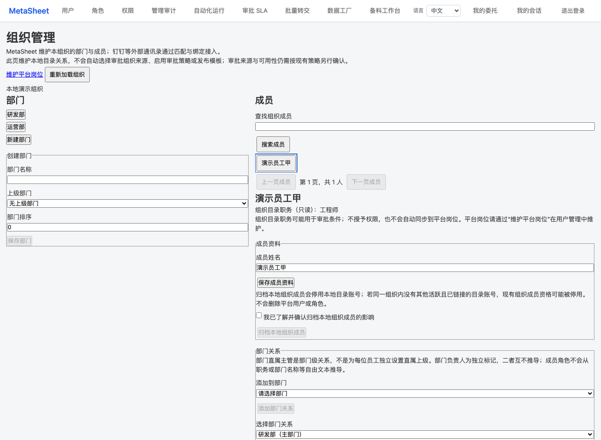
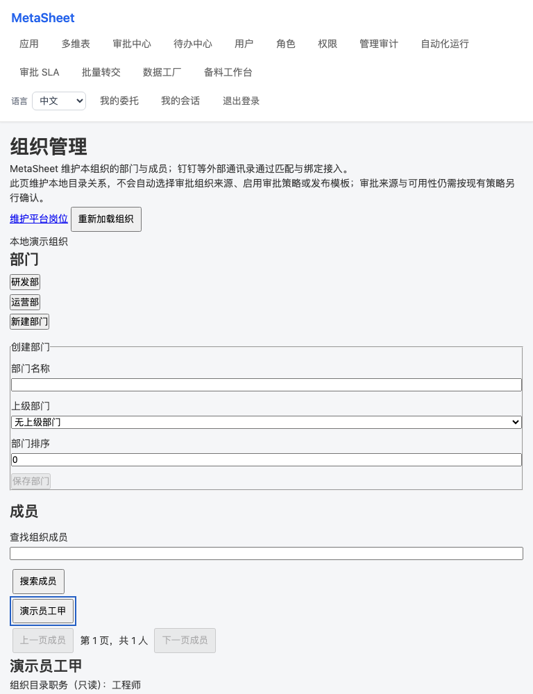
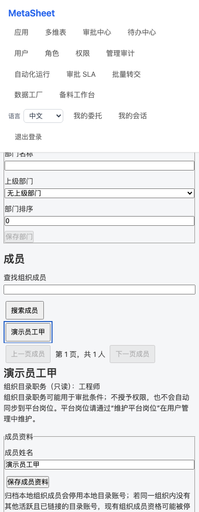

# Local organization workspace verification — 2026-10-27

Status: Draft candidate. Base 5b9ec081bba822c6c4f4668552c274ecc906a7e4. No merge, deployment, feature enablement, R71 change, real-tenant operation or UAT acceptance.

## Delivered surface

`/admin/organization` is an administrator route linked from the existing directory page. It maintains native departments, member names, explicit membership/primary department, department-level manager, and the separate department-head flag. Existing active same-org members can receive a local directory representation through the approved dedicated endpoint; it grants no organization membership, role, permission or login access. Old account-create refusal is unchanged.

Directory title is read-only. Platform position remains on user management; DingTalk title remains its provider-owned mirror. Text does not imply manager/head relationships or handler permission. This change does not unify those fields or select an approval routing source. Existing focus-mode allowlists are unchanged: this administration page is for ordinary platform mode, not a newly approved focus-mode exception.

Archive controls require explicit acknowledgement of existing effects, including possible deactivation of organization membership and the archived-sibling primary restriction. This is not a new detach operation. Disabled/missing local anchors remain read-only/unprovisioned.

Department-head API and schema belong to Draft #6589. This PR does not duplicate that implementation. The complete head UI requires the dependency plus controlled composition validation; no claim of deployment follows from either PR.

## Actual local evidence

| Gate | Actual result and boundary |
|---|---|
| Frontend client/view/admin-route | First run 108 passed, 2 failed. Two failed race fixtures clicked before Vue updated the disabled button after session invalidation. Added DOM settling and an assertion that the second request actually starts. Affected run: 2 passed, 65 filtered out. Total coverage is 110 parameterized cases across phases, not a fresh final whole-suite 110 run. |
| Stale-read negative control | Remove epoch/revision rejection: 2 matching failures, 65 excluded. Restored exact source. |
| Archive acknowledgement negative control | Remove only acknowledgement guards: member and department cases both fail with unexpected write count, 65 excluded. Restored exact source. |
| Native HTTP/auth/database | Fresh isolated UTF8 database, 452 migration ledger entries; workspace whole file 22/22 actual passes, no skips. Four native CI-contract cases pass. Own database stopped and retained. |
| Type and quality | Backend type-check passed. validate:all passed plugin validation and repository lint, then found TS1294 in the new client. Explicit fields replace parameter properties; emitted JavaScript is identical under two compilation targets. Frontend type-check continuation passed. New backend files lint passed. Frontend scoped lint passed; five new formatting warnings subsequently corrected with zero warnings on changed files. SFC script/render/style output is identical. Frontend build passed. The original failing validate:all receipt is retained; this is phase-based closure, not a fabricated new all-command exit. |
| Browser | Real main.ts / actual view, synthetic API interception at 1366/768/390. Native Tab/Enter/Space activates manager/head/projection; independent head state and 403 clearing are asserted. Nine synthetic writes were intercepted, zero API or external requests forwarded, zero page errors, no horizontal overflow. 910 source pins match before/after. Screenshots are viewport observations, not an entire-page or human assistive-technology acceptance claim. |
| Browser harness history | First attempt stopped because two existing shell GET fixtures were absent and exact select-label matching included option text. Those fixture/locator corrections preserved 15-second budgets and product source; three-width continuation passed. |
| Browser context/race | Two additional actual main-entry cases at1366: a real cross-tab storage event invalidates private state; held old success/403 responses cannot overwrite the new session loading or result. Three workspace reads per case, zero writes/forwarding/page errors;910 source pins retained. Earlier three-width cases were not repeated. |
| Native guard negative evidence | The historical R74 global-history/admin guard removals each produced the matching refusal failure. Current projection module and POST route block are byte-identical; current-main whole22 positive is separately executed. This is scoped historical applicability, not a current-main mutation rerun or whole dependency identity. |
| Combined dependency | Private34-path source union with Draft6589, tracked clean: six static registration controls passed; actual kernel manager-to-head frozen in-flight/new-instance case passed; new projection-to-membership-to-distinct-manager/head resolver case passed in a continuation database. The first shared fixture retained a canonical default anchor and blocked the second fixture before its case; only that unexecuted case was continued in an isolated clean clone with453-ledger migration. Two native cases across phases, not a fresh whole-suite run. The later public verification document and three PNGs are doc-only additions outside that runtime input set. No public merge or input Git-ancestry claim. |
| CI registration | Approval domain workflow and required-web script/generated manifest contain unique filters for both new specs and adminAccess. Existing trigger paths and required tokens retained. YAML parsed and generated token check passed. Actual PR CI remains required. |
| Independent review | Bounded source-only reviewer found no confirmed P1/P2. Main independently checked authorization, session fences and archive/title semantics. This is not execution evidence. |

Commands (run from the owned checkout with the pinned runtime wrapper):

- `pnpm --filter @metasheet/web exec vitest run --watch=false tests/localOrganizationClient.spec.ts tests/localOrganizationView.spec.ts tests/adminAccess.spec.ts`
- `pnpm --filter @metasheet/web exec vitest run tests/localOrganizationView.spec.ts -t 'keeps a newer workspace'`
- `EXPECT_DB=1 pnpm --filter @metasheet/core-backend exec vitest --config vitest.integration.config.ts run tests/integration/local-organization-workspace.db.test.ts`
- `pnpm --filter @metasheet/core-backend exec vitest run tests/unit/local-org-workspace-ci-contract.test.ts`
- `node scripts/ops/required-web-lane-token-manifest.mjs`
- `pnpm --filter @metasheet/core-backend type-check`, `pnpm validate:all` and the explicitly scoped continuation described above.
- `pnpm --filter @metasheet/web build`

## Screenshots

Synthetic data only. These show the current viewport after selecting a member; scrolling remains necessary for lower controls.

## Remaining gates and nonclaims

Private composition is locally evidenced above. Exact-head PR CI remains outstanding before final closure. No main-reference green or R74 backport green substitutes for this branch. Human accessibility, native OS select-menu acceptance, source/title/individual-manager policy decisions, owner gates, frozen transfers and live/provider gates remain separate. Historical 08:00 PUT remains inconclusive.
