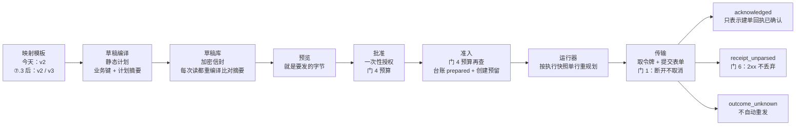

> **入库说明（2026-11-06，不属于冻结正文）**：本文件第 4 行起是冻结设计基线 v2.3 的逐字节副本，**已冻结，不再修改**；原文件 sha256 `5657c16a8d11a1ef460fdcbe9961dd82b360261dcdbed136d7e0866f6f831ec1`。校验：`git show HEAD:docs/development/takeover-beiliao-20260821/ipaas-yida-dev-baseline-v2.3-20261106.md | tail -n +4 | sha256sum`。owner 冻结后的裁定见同目录 `ipaas-yida-dev-baseline-addendum-20261106.md`，与本文冲突处以它为准。
> 正文的 `path:line` 在 origin/main `aba11f45b` 上核对，main 前进后使用前要重核。正文提到的 `dev-doc/` 冻结目录（附录 A、§12）、证据附件 A–D 与三份方案是起草会话的本机草稿目录，没有随本文件入库。

# iPaaS 与宜搭对接开发文档

**版本**：v2.3，**冻结设计基线**（2026-11-06）。经 owner 两轮修订意见、一轮独立复审和两轮 Codex 复审，三处 P1 在设计层关闭。冻结的是设计，不代表实现或测试通过；后续按文件级切片实施和验收。冻结副本与 sha256 见附录 A 目录下的 `SHA256SUMS`。
**代码基线**：origin/main `aba11f45b`。文中 `path:line` 都在这个提交上核对；main 前进后，合并或执行前要重新核对。
**上一版**：v1（2026-11-05，基线 `74f0756c9`）存档不再改；修订对照见附录 C。

**一句话现状**
- **宜搭对接**
  - 门 1+6 已合并（#6736、#6742）。门 4（#6750）、门 10（#6747）的 PR 已开，合并已按 owner 11-06 指示暂停（当前 head 与合并条件见 §5）。
  - 「收尾不卡在开发」只指一件事：用现有 v2 模板向测试表单发第一条。
  - 标准化对接（v3 进入发送、⑦.4 三个字段、⑦.5 切换对账）和生产切换都还要开发，约 9–11 支 PR（含 ⑦.3 的文档 PR-0；绑定改动若并入 ⑦.3 PR-1 则少一支）。
- **iPaaS**
  - 本期只做备料最小闭环：合成输入 → 具名只读操作 → 运行内传值 → 宜搭零网络预览（§10.3）。
  - 安全底座里的 S0-a、S0-c、开关登记、bearerToken 加密已合并；S0-b、SA06 在 Codex 线，未进 main。
  - R-69 两座桥等 owner 裁定，切换前另有硬门（§10.2）。

---

## 1. 目标与边界

**目标**（owner 2026-11-03 原话）：「请将我们之前讨论的类似 n8n 架构的 ipaas 以及可对接宜搭的标准化开发完成，请根据代码难度来规划模型及 effort」。

**优先级**
- 章程（AGENTS.md）规定唯一优先级是接管客户的备料系统，验收看「这个客户能用」。
- 平台通用能力只在客户提出需求时，从真实需求里抽取。
- 宜搭对接按 R-50 解封，算作备料线的交付项。
- 同时进行的线最多两条。

**n8n**：选择独立实现，只借鉴它的产品形态，不嵌入、不衍生它的代码，以避免商业集成授权方面的约束。

**BPMN 不适用**（owner 2026-11-06）
- 系统里的 BPMN 流程引擎和设计器不在范围内：`/api/workflow` 在 `ENABLE_BPMN_RUNTIME` 不是字面 `'true'` 时一律 503，默认关闭（`packages/core-backend/src/workflow/bpmnRuntimeConfig.ts:21-25`、`:45-48`；`packages/core-backend/src/routes/workflow.ts:30-35`）。
- iPaaS 编排、备料流程和系统自动化只建在两套引擎上：多维表自动化规则和数据工厂管道（R-69 打通的就是这两套）。
- 不依赖、不扩展、不打开 BPMN，也不为 BPMN 引擎补权限码或种子。BPMN 本身没有权限码，只靠这个开关挡住。
- **注意名字**：`workflow:all`、`workflow:write`、`workflow:create`、`workflow:execute` 这几个权限码虽然以 `workflow:` 开头，管的却是**多维表自动化规则**的管理（`canManageAutomation`，`packages/core-backend/src/multitable/access.ts:133-138`、`sheet-capabilities.ts:106-111`），不是 BPMN。它们不受本条影响，R-69 的服务账号还必须持有它们（§10.2.2）。

**安全红线**
- **values-free**：issue、PR 和证据里不写主机、IP、口令、authorityCode、appKey 或凭据，只写位置。
- **默认关闭**：一切外部写默认关闭，只有字面值 `'true'` 才打开；新开关登记在 `scripts/ops/global-history-flag-manifest`。
- **owner 层先批后动**：真实客户数据、写客户生产主表、外部系统写回、部署与发送。K3 的保存、提交、审核永久禁止。
- **宜搭**：合并、部署、打开发送开关各自单独批准。`INTEGRATION_YIDA_OWNER_SEND_ENABLED` 只由 owner 或现场操作员设置。
- **测试**：不调用真实的钉钉或宜搭。

**模型与 effort 按难度分配**

| 工作类型 | 模型与 effort |
| --- | --- |
| 机械改动：登记、钉子、文档同步 | Opus medium |
| 常规开发 | Opus high |
| 难的开发（并发、授权、执行器核心），以及设计、反驳、终审 | Fable 5.1 max |
| 保证类 PR 的独立核验 | Fable 5.1 max；必须执行变异，亲眼看到测试变红 |

---

## 2. 现状一览

标「已有」的两行，数字来自 9-29 的只读盘点（基线 `2888addb4`），之后没有重新核对。

| 组件 | 状态 | PR |
| --- | --- | --- |
| 多维表自动化规则 | 已有，客户在用。11 种触发、14 种动作，有条件与并行分支、审批步骤和执行日志 | — |
| 数据工厂管道 | 已有。一个来源对一个目标，有字段映射、失败行重放和增量水位；只能登录后手动启动 | — |
| S0-a webhook 出网守卫 | 已合并 | #5619、#5649 |
| S0-c 出站意图台账（单一赢家、令牌确认） | 已合并 | #6715 |
| `AUTOMATION_*` 开关登记 | 已合并 | #6716 |
| bearerToken 加密存储 | 已合并 | #6717 |
| S0-b 连接换源时强制重绑凭据 | Codex 线：覆盖范围内已验收，还没开 PR | — |
| SA06 持久投递隔离 | Codex 线：本地 P2 修复与独立复审都已通过；未进 main，未部署 | — |
| 宜搭 v3 映射 | 已合并，**只用于浏览器本地预演**；持久化发送只认 v2（§3） | #6714 |
| 宜搭多目标与表格来源（默认关） | 已合并 | #6718 |
| 旧表单规范化与 3 份合成模板 | 已合并 | #6711 |
| 两座桥 ADR（R-69） | ADR 已合并；R-69 待裁定，代码为 0 | #6710 |
| R-70 十门裁定与首发手册 | 已合并 | #6727 |
| R-71 宜搭标准化路线（6 个槽） | 已合并 | #6733、#6739 |
| ⑦.1 门 1+6 | 已合并 | #6736、#6742 |
| ⑦.2 门 4+10 | PR 已开，合并暂停（§5） | #6747、#6750 |
| ⑦.3 v3 进入发送路径 | 方案 v1 已冻结（附录 A）；本版补了身份与去重修订 | — |
| ⑦.4 三个字段 | 方案 v1 已冻结；本版修订 D1 等项（§7、附录 A） | — |
| ⑦.5 切换对账 | 还没写方案 | — |
| iPaaS 最小闭环（C1、S2） | 首片契约已汇入（Codex 起草，Claude 审查，§10.3.1）；未实现 | — |

---

## 3. 宜搭单行发送链路

本节的链路图画的是 **⑦.3 合并后的目标链路**。今天（`aba11f45b`），持久化、批准、准入、运行器都只认 v2；v3 只出现在浏览器本地预演和主机侧从不落库的本地重算里。

### 3.1 现状与目标

| 环节 | 今天（`aba11f45b`） | ⑦.3 合并后 | 证据 |
| --- | --- | --- | --- |
| 持久化路径的草稿编译 | 只收 v2：`compileYidaDraft = compile(input, [2])` | 新开持久化发送入口，收 v2 和 v3；初始化仍只用 v2 入口（⑦.3·E1） | `lib/yida-draft-compiler.mjs:181-185`；`lib/yida-draft-plan.mjs:1-5` |
| 浏览器预演、主机本地重算 | v2 和 v3，从不落库。主机侧的本地重算入口 `compileYidaLocalDraft` 今天没有运行时调用者 | 不变 | `lib/yida-draft-compiler.mjs:190-192` |
| 草稿库、预览、批准 | 都经 `compileYidaDraft`。v3 在编译时被拒，折成 `UNAVAILABLE` | 接受 v3；计划摘要只给 v3 加 `mapping: 3`（⑦.3·B2） | `lib/yida-draft-plan-store.mjs:185`、`:235`、`:274`；`lib/yida-send-authority-primitives.mjs:124`、`:210` |
| 运行器 | `snapshot.config.version !== 2` 时报 `SNAPSHOT_INVALID` | 白名单改为 `{2, 3}` | `lib/yida-delivery-runner.mjs:153` |
| 回读比较 | 只认 v2，没有运行时调用者 | 版本感知（⑦.3·H），给 ⑦.5 留接缝 | `lib/yida-readback-observation.mjs:82` |
| 初始化、登记目标 | 非 v2 报 400 | 不放开（⑦.3·E1） | `src/routes/integration-yida-owner.ts:216` |
| 草稿来源 | 多目标开关关：只收粘贴的 `rowsText`。开：可从表格或视图读，但只回 `rowsText`，不回记录 id | ⑦.3 不改；§7.2 的源记录绑定补上 | `src/routes/integration-yida-owner.ts:324-351`；`src/integration/yida-sheet-source.ts:110` |
| 物料编码 ② | 没有生成器 | ⑦.4 PR-1、PR-2 | 代码目录（plugins、packages、apps、scripts）里 `WLBH` 为 0 处；仓库里只有登记册 R-71 行提到 |
| 发料确认日期回写 ④ | 没有任何回写代码 | ⑦.4 PR-5 | 全仓查 `issueConfirm`、`issue_confirm` 为 0 处 |
| 切换对账 ⑤ | 没有；只有一个未被调用的远端 GET 客户端 | ⑦.5（方案未写） | `lib/yida-form-readback.cjs:6` |
| 发送开关 | `INTEGRATION_YIDA_OWNER_SEND_ENABLED`，字面值 `'true'`，每次动作重读 | 不变 | `src/index.ts:655`；`src/integration/yida-owner-runtime.ts:175-179` |

路径缩写：`lib/` = `plugins/plugin-integration-core/lib/`，`src/` = `packages/core-backend/src/`，`migrations/` = `packages/core-backend/migrations/`，`web/` = `apps/web/src/`。

**「不卡在开发」的适用范围**
- **适用**：1 号槽（物料表测试副本）用现有 v2 物料模板、粘贴合成数据发第一条（R-70 ④）。只需要现场版本和窗口一、窗口二，各自 owner 另批。
- **不适用**：
  - 任何 v3 草稿进入发送：R-70 ③ 要求在首发成功之后，以单独一支 PR 进入。
  - 物料编码、发料确认日期回写、项目规格型号：⑦.4 的六支 PR 都还没开。
  - 正式表单：2–6 号槽要打开 `INTEGRATION_YIDA_MULTI_TARGET_ENABLED`（owner 另批）；发往生产表单在第一个项目切换时另批（R-70 ④）。
  - 切换对账 ⑦.5：方案未写，代码为 0。

**⑦.3 完成后的目标链路**。今天 v3 只走到浏览器预览面板的本地预演（`StockPreparationYidaPreviewPanel.vue`，不落库、不出网）；服务端的草稿库、预览、批准、准入、运行器都拒绝 v3（§3.1）。

### 3.2 去重保证（校准）

**保证什么**
- 交付台账按「目标 + 七键业务摘要」做**创建预留**：同一目标下七键摘要相同的第二次创建，在准入事务里被拒，不发送。
- 结果不明的行（`outcome_unknown`，含 `receipt_unparsed`）保留预留，**永不自动重发**，由人到宜搭核对。

**不保证什么**
- 不保证「同一源行只建一条」：七键任一值变了就是新摘要，可以再建一条（§3.3）。
- 只认得经我们写过的行。旧系统写的行由 ⑦.5 另行登记（§8）。

| 项 | 现状 | 证据 |
| --- | --- | --- |
| 创建围栏 | 部分唯一索引 `uniq_integration_yida_delivery_create_business`，列 `(tenant_id, COALESCE(workspace_id, ''), target_ref, business_key_digest)`，条件 `intent = 'create'`，不看状态（`not_sent` 也保留预留） | `migrations/091_create_integration_yida_create_fence.sql:4-5`、`:45-47` |
| `business_key_digest` | 七键业务键串的 sha256。业务键串按目标名排序，可空键的空值统一为 `''` | `lib/yida-static-plan.mjs:634-643`；`lib/yida-delivery-runner.mjs:170` |
| 物料表的七键 | 项目号、图号、名称、规格、材质、版本、父组件图号；规格、父组件图号可空 | `docs/.../yida-legacy-templates/material.json:9-21` |
| `idempotencyKey` | **不在业务键里**，只映射到 payload 字段 `sourceLineId`，不参与去重 | `material.json:83-88` |
| 同一草稿内重复 | 规划器把同键行标 `DUPLICATE_LOCAL_KEY`；编译器拒绝；草稿行表 `UNIQUE (operation_id, business_key_digest)` | `lib/yida-static-plan.mjs:743-754`；`lib/yida-draft-compiler.mjs:109-112`；`migrations/093_create_integration_yida_draft_plans.sql:37` |
| 台账行不可改 | 身份列改动报 `YIDA_DELIVERY_IMMUTABLE`；状态只能单向走；禁止删除；审计只追加 | `migrations/090_create_integration_yida_delivery_ledger.sql:69-137` |

**冲突时的表现（现状）**
- 七键冲突在准入事务里撞索引，逐层折成 `YIDA_SEND_APPROVAL_UNAVAILABLE`，HTTP 503（`lib/yida-delivery-store.cjs:195-197`、`:212`；`lib/yida-send-authority-primitives.mjs:33-34`；`src/integration/yida-send-approval-service.ts:61-64`；`src/routes/integration-yida-owner.ts:42`）。准入整体回滚，授权仍是 `approved`。
- 所以今天「已被预留」和「数据库不可用」在界面上是同一个样子，没有专门的错误码。
- 同一授权再提交：只回历史，不再发送（`src/integration/yida-send-approval-service.ts:425-428`；`lib/yida-owner-send-port.mjs:117-122`）。
- 同一行另起授权：准入时读到已有行，判 `CONFLICT`（409，`yida-send-approval-service.ts:438`）。

**结果不明（现状）**
- 五个原因：`transport_unknown`、`commit_unknown`、`receipt_invalid`、`manual_recovery`、`receipt_unparsed`（`lib/yida-delivery-store.cjs:18-20`）。`receipt_unparsed` 表示已收到 2xx 状态行，但正文不可用（`lib/yida-form-transport.cjs:251-254`）。
- `acknowledged` 的唯一写入点是 `finish()`（`lib/yida-delivery-store.cjs:301`），它要求行仍是 `dispatching`，且持有内存里的认领令牌（`:298-299`）。结果不明之后没有回头路。
- 面板只显示 `outcome_unknown`。`receipt_unparsed` 只在审计表里，观察 DTO 只有 `{id, status, durable}`（`src/routes/integration-yida-owner.ts:122-134`）。

**现状缺口：崩溃后停在 `dispatching` 的行**
- claim token 已持久化：`claim()` 把它写进台账行的 `claim_token` 列（`lib/yida-delivery-store.cjs:271-273`；`migrations/090_…sql:21`）。只在内存里的是执行能力（运行器里的认领上下文）和调用者持有的令牌副本（`lib/yida-delivery-runner.mjs:329-330`）。`finish()` 要同时对上 actor 和令牌（`lib/yida-delivery-store.cjs:299`）。
- 进程在发送中途死掉后，没有任何代码路径再对这一行调用 `finish()`，行停在 `dispatching`，七键保持预留。
- 门 2 的手册只处理 `prepared → not_sent`（`lib/yida-delivery-store.cjs:318-331`），不处理这种行。

**建议首发之前补一份 `dispatching` 恢复手册**（owner 逐次批准；不能照搬 `prepared` 手册）
1. **先确认持有进程已退出、不会恢复。** 依据是进程级事实（后端进程已停止或已重启，且这一行的认领发生在当前进程启动之前）。不能凭超时，也不能凭页面一直在等。
2. **锁行后重查状态。** 单事务内 `SELECT … FOR UPDATE` 这一行；状态已经不是 `dispatching`（例如 ACK 先提交了）就什么都不做，直接退出。
3. **只改状态，不动其它。** 保留身份列、`claim_token`、`claim_actor_id` 和全部创建预留。同一事务里把状态写成 `outcome_unknown`，并写一条 `manual_recovery` 审计。不释放预留，不重新发送。之后由人到宜搭核对，与其它结果不明的行一样处理。
4. **合成 PG 验收**（本机 PG，合成数据）：
   - ACK 先提交：手册事务锁行后看到 `acknowledged`，退出，行和审计都不变；
   - 恢复先提交：之后迟到的 `finish()` 因状态不是 `dispatching` 被拒，行保持 `outcome_unknown`，审计只多一条 `manual_recovery`；
   - 事务中断：在写审计之前中断，整体回滚，行仍是 `dispatching`，审计不变。
5. 守卫触发器今天允许 `dispatching → outcome_unknown`（`migrations/090_…sql:91-93`），所以这份手册不需要迁移。

### 3.3 七键变了、物料编码不变：怎么处理

**今天的行为：没有任何处理**
- 源行 X 以七键 K1 发出并 `acknowledged`。之后 X 的名称被改正，七键变成 K2。
- 再起草时围栏元组不同，预留成功，于是**建出第二条宜搭记录**。两条的 `sourceLineId` 都是 X 的键。
- 操作员看到的只是一次普通的预览、批准、提交，没有任何提示，因为预览不查台账（`src/routes/integration-yida-owner.ts:148-174`）。
- 加上 ⑦.4 的物料编码（编码由 `idempotencyKey` 和项目号算出）后，两条宜搭记录会是**同一个 `WLBH-` 编码**。
- 反方向：七键相同、键不同（例如复制一行后改键）时，围栏拒绝第二条，操作员在准入时看到 503。

**建议（D16，待 owner 裁定）：把「逻辑创建身份」和「本次的物理源记录绑定」分开**

v2 曾建议按源摘要（含表 ID、记录 ID）建围栏。但物料编码只由键值和项目号算出，不含表 ID 和记录 ID。下面这种情况，源摘要和七键摘要都会变，编码却不变，两道围栏都挡不住，结果是两条同码记录：

> 原行发送成功 → 删除后重建，或迁到另一张已登记的表 → 保留 PLM 唯一键，同时改正名称或版本 → 再起草。

所以改成两样东西各管各的：

| | 逻辑创建身份 | 物理源记录绑定 |
| --- | --- | --- |
| 内容 | 目标 + 键值（服务器读出的 `idempotencyKey`）+ 拆分项目号，也就是物料编码的全部输入 | 源表 ID、记录 ID、键列 ID（§7.2） |
| 摘要 | `creation_identity_digest = sha256(canonical({ version: 1, kind: 'yida-creation-identity', keyValue, projectNo }))` | `source_record_digest`（§7.2） |
| 用途 | **身份围栏**：同一目标下同一身份只能创建一次 | 授权复核（§7.2）和回写定位（§7.3）；不作围栏 |
| 删除重建、迁表后 | 不变 | 变 |

**身份围栏**
- 台账加部分唯一索引 `(tenant_id, COALESCE(workspace_id, ''), target_ref, creation_identity_digest) WHERE intent = 'create' AND creation_identity_digest IS NOT NULL`，与七键围栏并存。
- 编码是身份的函数，所以「同码」必然「同身份」：同一目标下第二次创建在准入事务里被拒，与物理记录换没换、七键变没变都无关。
- 本期**不支持迁移承接**：删除重建、迁表后的同一身份，一律拒绝再次创建，转人工对账（由人到宜搭核对已有记录）。原台账行的物理绑定对不上当前记录，所以它也不会回写（§7.3 的 `row_absent` / `sheet_mismatch`）。以后要承接，另写方案。
- 独立错误码 `YIDA_SEND_APPROVAL_IDENTITY_RESERVED`（409），登记进路由 `statuses`（`src/routes/integration-yida-owner.ts:36-49`）、前端 `errorStatuses`（`web/services/integration/yidaOwner.ts:122-129`）和面板文案：「此物料行在该目标已经创建过，不再新建；请到宜搭核对。」
- `approve()` 在选择行之后先只读查一次台账，命中就用同一个码拒绝，操作员在授权生成之前就能看到。准入事务里的唯一索引是最终保证。

**无绑定的草稿不能靠转换类型来保证**
- v2 写过「无绑定草稿不能带 `generated` 字段，所以永远发不出带 `WLBH-` 编码的内容」。这句推论不成立，已删：普通映射或常量同样可以发出相同的字符串。
- 持久化编译入口对无绑定的 `generated` 仍然拒绝，但这只是一道附加检查，不是保证。
- 正式目标要硬性保证，就在**目标准入处**要求每一行都有有效身份绑定：发往正式目标的行没有绑定，批准和准入都拒绝（D20）。测试副本可以放行无绑定行，只按七键去重。

**回归测试**
- **文件**：真库 `packages/core-backend/tests/integration/stock-preparation-yida-create-fence-realdb.test.ts`（已在锁协议步骤里，不增加文件数）。单元镜像放进 `plugins/plugin-integration-core/__tests__/yida-delivery-store.test.cjs`，挨着已有的业务冲突用例（`:398`、`:413`、`:424`）。
- **CF1 钉住现状**（无绑定）：行 X（`sourceLineId = 'syn-line-1'`、七键 K1）走到 `acknowledged`（假回执）；行 X′ 同 `sourceLineId`、名称改一个字（七键 K2）。X′ 的 `prepare` 成功、`reused === false`，台账 2 行。这是测试副本上被接受的残余。
- **CF2 新记录 ID + 同 PLM 键 + 七键变化**（身份落地后）：X 带绑定（表 S1、记录 R）走到 `acknowledged`。删除 R，合成拉取重建 R′（同键、新记录 ID），同时改正名称（七键变）；另一例改为迁到已登记的表 S2。对 R′ 起草后，批准以 `YIDA_SEND_APPROVAL_IDENTITY_RESERVED` 被拒。另一例检验索引本身：R′ 的授权在 X 准入之前就已批准，等 X 准入并 ACK 后再准入 R′，撞身份索引被拒。台账仍 1 行，X 的状态和审计不变，表单请求 0 次。
- **CF3 并发准入**：两份不同的草稿（不同操作、不同物理记录或不同七键）带相同的身份摘要，在两条连接上同时准入。恰好一条 `prepared`，另一条以身份冲突回滚；表单请求最多 1 次（只有赢家可能发送）。
- **变异**：删掉身份索引，CF2、CF3 变红；身份摘要改成从 `source_record_digest` 算，CF2 变红；把 `creationIdentityDigest` 从快照比对里去掉，已有的「rejects every changed snapshot field」用例（`:197`）变红。先看到红，再逐字节还原。

**十道门的位置**（R-70）

| 门 | 关在哪 | 怎么关 |
| --- | --- | --- |
| 1 | 传输 | 代码：只在 `execute()` 入口检查调用方信号，准入后的创建不因请求断开而取消（#6736） |
| 2 | 台账 | DBA 手册：`runbook-yida-prepared-ledger-cancel-20261104.md`，单事务把 `prepared` 改成 `not_sent` 并写 `cancel` 审计，owner 逐次批准 |
| 3 | 现场 | L3 得 `ok`、L4 成功，L4 之前全库备份与 `docker\app.env` 副本在手 |
| 4 | 批准与准入 | 代码：同一份预算定义，批准时与准入前各查一次（#6750） |
| 5 | 现场 | L3/L4 在服务器本机浏览器经 localhost 完成 |
| 6 | 传输 | 代码：状态行之后脱离，正文 5 秒超时；2xx 但正文不可用时记 `receipt_unparsed`（#6736） |
| 7 | — | R-70 ① 对首发由 owner 接受风险，不列为常规使用的代码前置 |
| 8 | 现场 | 在客户机上用合成字串实测 PBKDF2，只报毫秒数；8×T 加两次出网往返明显低于 10 秒才继续，建议 T < 300 ms |
| 9 | 现场 | 锚点账号的 GET 在开关打开前后都显示 `initialized` |
| 10 | CI | 代码：关停超时测试，加真库步骤零跳过检查（#6747） |

---

## 4. 宜搭对接标准：字段来源方式与回写

**原则：谁有数据，谁负责这个字段。**
- 每个宜搭字段由客户逐个选择「来源方式」。
- 我们把几种方式都备齐；对某个客户选哪种只是配置（映射模板加开关），不改代码。
- 宜搭表单是客户自己在低代码平台上搭的，这样客户以后改表单时影响面最小。

### 4.1 来源方式

| 方式 | 含义 | 要不要写代码 |
| --- | --- | --- |
| ① 多维表列直送 | 值存在备料表的普通列里，原样或经封闭转换后发给宜搭 | 只有这一列要从 PLM 带入时才要写：模板加列，拉取时填值 |
| ② MetaSheet 生成 | 按确定性规则从输入生成，输入相同则值相同。输入必须绑定服务器确认的源表、源记录和拆分项目（§7.2）；手写的草稿没有绑定，不能使用生成字段 | 写一次，作为标准能力复用 |
| ③ 宜搭自填 | 客户在宜搭里配置流水号、提交时间、数据联动等，我们不送这个字段 | 不用写：映射里不配这个字段，在模板说明和现场清单里标「宜搭侧字段」 |
| 回写 | 宜搭那边处理完以后，把结果写回多维表，比如发料确认日期 | 每种回写写一次；对每个客户用开关和目标名单选开或关，默认关 |

### 4.2 映射模板的硬规则（已在代码里）

- **只新建、按业务键去重。** 模板都是 `intent: create`。物料表的业务键与旧系统的查重条件一致：项目号、图号、名称、规格、材质、版本、父组件图号，其中规格和父组件图号可以为空。
- **业务键里没有 `idempotencyKey`。** 它映射到 payload 字段 `sourceLineId`，不参与去重（`material.json:9-17` 对 `:83-88`）。
- **跨批次的创建预留。** 交付台账对「租户、工作区、目标、七键业务摘要」建唯一索引（`migrations/091_create_integration_yida_create_fence.sql:45-47`）。同一目标下七键摘要相同的第二次创建被拒、不发送；七键任一值变了可以再建一条（§3.3）。结果不明的行保留预留、永不自动重发。这个索引只认得经我们写过的行，旧系统写的行由 ⑦.5 另行登记。（§3.3 的「身份围栏」是建议，还没有落地。）
- **不做查表。** 需要别表的值，由上游经批准的读取补成列。表格来源只收普通存储的标量列，公式、lookup、rollup 列一律拒收。
- **下拉必须有静态选项。** 下拉和单选要带 1–64 个静态选项，值不在选项里报 `FIELD_OPTION_INVALID`。宜搭的「项目号」是会增长的下拉，模板里先按文本控件表达（现场问题 Q1）。
- **数量除不尽就拒绝。** 组合项目号拆分后数量均分，除不尽报 `QUANTITY_NOT_DIVISIBLE`（R-71 ③），不四舍五入、不留空。
- **v3 转换是封闭集合**：`direct`、`copy`、`constant`、`concat`，不运行用户代码。

### 4.3 这个客户的三个字段

客户答复之前，默认按旧系统现在的做法，也就是 R-71 ②④⑥ 已定的方式，让上线后客户看到的行为不变。客户的选择如果改变 R-71 ②④⑥，由 owner 重新裁定并登记。

| 字段 | 在哪 | 旧系统怎么填 | 可选方式 | 要问客户什么 |
| --- | --- | --- | --- | --- |
| 物料编码 | 宜搭物料表的文本字段 | 旧中间件建记录时生成 `WLBH-` 加随机 UUID | ② 或 ③ | 保留 `WLBH-` 格式，还是改用宜搭流水号？下游有没有人依赖这个格式？通过接口创建的记录会不会生成流水号？ |
| 项目规格型号 | 宜搭物料表的文本字段 | 按项目号查本地 BOM 表 | ① 或 ③ | 这个值在客户的宜搭里有没有？有就由宜搭联动带出；没有就由我们从 PLM 带入（现场问题 F1） |
| 发料确认日期 | 不在宜搭：旧系统在宜搭建好记录后，写回自己的本地仓库表 | 建记录成功后写本地日期 | 回写：开或关 | 备料这边需不需要看到这个日期？ |

注意：本文中的「发料确认日期」只表示宜搭「发料确认」表单记录的**建单回执已确认（ACK）**的日期，不表示审批通过或实物已发料（§7.3）。

---

## 5. ⑦.2 门 4 与门 10

两支都不加迁移和开关，也不改 `index.ts`。门 10 先合；门 4 在它之后更新到新 main、重跑 CI 再合。

### 5.1 当前 head 与合并条件（2026-11-06 00:49Z 核对）

历史上的 CI 全绿不能当作合并依据。合并时以下表当前 head 和逐项条件为准，到时还要重核一次。

| | #6747（门 10） | #6750（门 4） |
| --- | --- | --- |
| 当前 head | `ecd2c1f0d`：在 `ec9a8fc7d` 之上合入 main `aba11f45b`，解了与 #6693 在 `plugin-tests-parallel-contract.test.mjs` 的冲突（两边的变异条目都保留） | `f22074e9c`，基于旧 main `a066f61c7` |
| 当前 head 上的 CI | 34 项通过、1 项跳过（11-06 00:4xZ 跑完） | 基于旧 base 的 35 项通过、1 项跳过；更新后要重跑 |
| 可合并状态 | MERGEABLE / CLEAN，已转为正式 PR | MERGEABLE / CLEAN，仍是草稿 |
| 独立核验 | 第 1 轮 FIX_FIRST（`7e2805c9e`，名册缺口），已在 `974f41a80`、`ec9a8fc7d` 修。名册修复的变红已在本地见证（见下） | PASS；测试缺口已在 `f22074e9c` 补，变红已见证 |
| 与 main 的重叠 | 无 | main 自 `a066f61c7` 以来改过 `encrypted-store-probe.test.ts`，#6750 也改了它；模拟合并无文本冲突，语义由更新后的 CI 判定。main 新增的唯一迁移 `zzzz20261102150000_dingtalk_login_repairs` 与宜搭无关 |
| 叠加模拟 | — | 在 #6747 当前 head 上模拟合并 #6750，没有冲突 |

**门 10 名册修复的本地见证**（11-06，合成，不推送）
- 在 `ecd2c1f0d` 上，`classify(['scripts/ops/vitest-zero-skip.mjs'])` 为 `true`。
- 删掉 `integration-guard-guarded-paths.mjs` 里那一条后，新进程里结果为 `false`。
- 文件按 sha256 恢复，与原来逐字节相同；worktree 没有改动。

**合并条件（两支都要满足，逐支执行）**
1. owner 在本会话重新批准合并（11-06 暂停）。
2. 合并前 head 等于 API 返回的 head，按 SHA 钉定合并。
3. 那个 head 上必跑项和非必跑项全部跑完、全部通过。
4. head 之后 main 没有前进；前进了，先查新提交有没有迁移或改到同一批文件，再更新、重跑。
5. 合并前通知备料线会话。
6. 用 REST squash 合并（zensgit），之后切回 skiyakubali0-cloud，按 patch-id 核对合入内容。
7. #6750 只在 #6747 合入之后更新：合入新 main，重跑 CI，转为正式 PR，再逐项过 1–6。
8. 两支的合并提交号交给备料线，用于 R82 切版（§9）。

### 5.2 门 4（#6750）：预算在准入前检查

**问题**
- 请求正文是 JSON 里再套一层 JSON，`"` 和 `\` 会翻倍，所以 133 KB 的预览最多能变成 264 KB 的正文。
- 运行器在传输层校验输入之前，就把 `externalWriteAttempted` 设为 true。所以超大正文会落成 `outcome_unknown`，而实际上什么都没发出去。

**改法**
- **单一定义**：`plugins/plugin-integration-core/lib/yida-send-budget.cjs`，包含常量、`encodeYidaFormRequestBody`、`boundYidaExecutionSnapshot` 和 `assessYidaSendBudget`。
- **镜像**：主机侧 `packages/core-backend/src/integration/yida-send-budget.ts`，前端 `apps/web/src/services/integration/yidaSendBudget.ts`，各配一个等值钉子测试。
- **同步原语 `sendBudget`**：批准时在写授权之前调用，准入时在 `prepareInTransaction` 之前调用。超预算返回 422 `YIDA_SEND_APPROVAL_LIMIT`。
- **凭据部分按保守上界预留**，约 25 KB，不解密。
- **owner 已定**：a1 b1 c1 d1 e1 f1 g1 h1，逐项见附录 A.1。

**核验（Fable 5.1 max）：PASS**
- 971 个规划器接受的用例、9,282 次真实流水线运行，反例为 0。
- 最紧的边界是 0 字节：262,144 字节两侧都接受，262,145 两侧都拒绝。
- 发现一个测试缺口：「选中行」这一项没被任何测试钉住。已补一个原语用例和一个真库用例，去掉它两个用例都会变红。
- LOW：源码扫描挡不住换写法的字面量，比如 `512 * 512`；结构断言仍然成立，这一项接受现状。
- 出处：以上数字和结论出自 #6750 PR 说明的独立核验一节，已冻结为证据附件 C（附录 A）。

### 5.3 门 10（#6747）：关停超时与真库零跳过

**关停超时测试**
- 用假时钟，对三个宜搭运行时逐一验证：
  - 9,999 毫秒时 `stop()` 还在等；
  - 10,000 毫秒时以 `SHUTDOWN_TIMEOUT` 拒绝；
  - 连接池始终不关。
- 它驱动的是 `index.ts` 里真实的 `stop()`。

**零跳过检查** `scripts/ops/vitest-zero-skip.mjs`
- 读锁协议真库步骤（14 个文件）的 JSON 报告，遇到任何 skip、todo、pending、失败、缺文件或数量不符都失败。
- vitest 1.6 把 `it.skip` 算作 passed，所以只能看每个用例自己的状态。
- 已知限制：提前 `return`、一个断言都没有的用例仍算通过，vitest 1.6 没有 requireAssertions。所以门 10 的承诺写成「零 skip/todo/pending」。

---

## 6. ⑦.3 v3 映射进入发送路径

**现状**：v3 只出现在浏览器本地预演，以及主机侧从不落库的本地重算入口里（`compileYidaLocalDraft`，今天没有运行时调用者）。持久化、批准、准入、运行器、回读都写死只认 v2。另外，选择行的反推函数 `reconstructRows` 在结构上就不认 v3，这不是开关能解决的。

**修法五块**
1. **编译**：新开一个「持久化发送」编译入口，接受 v2 和 v3；初始化仍只用 v2 入口。
2. **计划摘要**：只给 v3 加版本标记 `mapping: 3`，v2 的摘要输入一个字节都不变。
3. **选择行**：v3 不再从 payload 反推，改用共享的分配展开函数，再投影到 v3 实际引用的列。
4. **运行器与回读**：版本白名单从 `{2}` 改为 `{2, 3}`。
5. **预算**：v3 在草稿创建时就过门 4 的同一份预算。v3 的常量和复制可以产生 369–492 KB 的正文。

不需要迁移：版本只存在于加密信封里，台账和各表只存摘要。

**决策**：⑦.3·A–H 的选项和推荐见附录 A.2。为了不和 ⑦.4 的 D1–D15、现场问题 F1、iPaaS 的 C1 混淆，⑦.3 的选项一律写成「⑦.3·C1」「⑦.3·D1」「⑦.3·F1」这种形式。决策 A（PR-0）是窗口一的硬前置（§9.3）。

**PR 拆分**
- **PR-0**：文档加一条纯测试，约 +20 行。必须在窗口一的 L4 之前合并（§9.3）。本轮不推送，所以还没开。
- **PR-1**：⑦.3 本体，一支 PR。
  - 从门 4 合并后的 main 开分支。
  - 源码约 +260/−40 行（约 12 个文件），测试约 +650/−20 行（约 14 个已有文件）。
  - 不新增迁移、开关、lib 文件或测试文件，不碰 `index.ts`。
  - 按 R-70 ③，在第一条测试表单发送成功之前保持草稿状态。
  - Opus high 实现，Fable 5.1 max 核验。

**核验必须打的点**
- v2 字节不变：给 v2 加字面金标。
- 同一行先经 v2 发出、再用 v3 起草时，准入被拒、不发送。
- 改信封里的版本号会让重编译校验失败。
- v3 草稿超预算时，在创建时就被拒。

**本版对 ⑦.3 方案的两处更正**
- 方案 §2.1 写「同一行先经 v2 发出、再用 v3 起草：准入被拒」。这只在七键不变时成立，应改成「同七键」（§3.3）。
- §7.2 的源记录绑定改的是同一批文件（编译器、草稿库、原语、运行器、台账）。它要么并进 ⑦.3 PR-1，要么单开一支「绑定」PR，在 ⑦.4 PR-2 之前合。两种都要 owner 定（附录 A.3 的 D12、D19）。

---

## 7. ⑦.4 物料编码、发料确认日期、项目规格型号

⑦.4 整体取决于客户对 §4.3 的答复。它不在**现有 v2 测试表单首发**的关键路径上，但标准化对接和生产切换需要它。建议先问客户一轮，回来后只做选中的部分。

### 7.1 关键发现

**模板加列会打断存量表**
- 拉取前的探针发现目标表缺模板列，就报 422 `TARGET_SCHEMA_INCOMPLETE`。
- 现有的项目表修复路由只同步选项、打列锁，不补列。
- 所以要先有补列路径（PR-3），所有新列也要一次进模板。

**物料编码（选 ② 时）**
- 规则：`WLBH-` 加大写 UUIDv5。默认带连字符，共 41 个字符（D2 默认 a）；旧代码的具体格式待 owner 对照 `StockInfoController.java:1896` 确认。
- 输入是服务器读出的备料行唯一键（`idempotencyKey` 的值）和拆分后的单个项目号；输入必须有 §7.2 的源记录绑定（修订后的 D1）。
- 编码本身不含源表 id 和记录 id。所以部署表迁到项目表、记录删除后重建，编码都不变；编码的全部输入就是「逻辑创建身份」，由身份围栏保证同一目标下只建一次（§3.3）。物理绑定里含这两个 id，授权复核和回写靠它们认出表换了、记录换了。
- 只计算，不存到行上；必须是同步纯 JS，因为浏览器预览也要算。
- 在 v3 里作为新的封闭转换 `generated`，放在拆分之后。持久化编译入口遇到 `generated` 而该行没有绑定，报行问题 `SOURCE_UNBOUND`，整份草稿被拒；本地预演不要求绑定。
- 列 id 不能叫 `materialCode`：客户包已装的 `ext_materialCode` 是 ERP 物料号，会冲突。

**发料确认日期回写**：见 §7.3。

**项目规格型号（选 ① 时）**
- 现有读取计划里没有项目级的规格型号字段，来源未知（现场问题 F1）。
- 列 `projectSpecModel` 先以空列上线，等现场答复后再填。

### 7.2 源记录身份

**五个容易混的标识**（三个主要的，加两个相关的）

| 标识 | 是什么 | 重拉时 | 重建草稿时 | 证据 |
| --- | --- | --- | --- | --- |
| R-71 ② 的「备料行的记录 id」 | 裁决原文用语，代码里没有同名概念。规范化文档把它对到 `idempotencyKey`，并注明旧系统用的是备料表自增 id | — | — | `decision-register.md:75`；`yida-legacy-form-normalization-20261103.md:55`、`:73` |
| `idempotencyKey` | 备料表唯一键列。拉取行是 `JSON.stringify({ projectNo, componentSourceId, parentSourceId, path })`；人工行是 `manual:v1:<记录 id>` | 同一 BOM 路径不变；路径变了就是新键 | 与草稿库无关。在草稿里它只是 `rowsText` 中的一个字符串，服务器不对照任何表 | `lib/stock-preparation-bom-expansion.cjs:1633-1640`；`lib/stock-preparation-manual-rows.cjs:10-13`、`:36`；`src/routes/integration-yida-owner.ts:325-327` |
| 草稿 `row_key` | 新建草稿操作时每行一个 `randomUUID()`，进授权行和台账行 | 无关 | **会变**：源内容任一字节变，就是新计划摘要、新操作、新 `row_key` | `lib/yida-draft-plan-store.mjs:211-214`、`:224`；`migrations/093_…sql:30` |
| 多维表记录 id | `meta_records.id` | 不变；删除重建会变；部署表迁项目表会变 | 草稿里根本没有：表格来源读取时只用它过滤权限，不返回 | `src/integration/yida-sheet-source.ts:110`、`:143-163` |
| `business_key_digest` | 七键业务键串的 sha256 | 七键不变则不变 | 不变 | `lib/yida-draft-compiler.mjs:160`；`migrations/091_…sql:45-47` |

**今天没有服务器确认的源记录**（全库查过，见冻结附件 A 的 A8）
- 台账、草稿行、授权行都没有源表、源记录或项目号列（`migrations/090_…sql:3-26`；`095_…sql:9-19`）。
- 草稿操作只存粘贴文本原样（`lib/yida-draft-plan-store.mjs:217-218`）；表格来源也只把 `rowsText` 交下去（`src/routes/integration-yida-owner.ts:348-351`）。
- 执行摘要的输入里没有源（`lib/yida-execution-digest.cjs:8-15`）。
- 表格读权限只在起草那一刻查（`src/integration/yida-sheet-source.ts:115-121`），批准、准入和以后的回写都不再查。
- 结论：今天手写的 JSON 草稿与从表格读出的草稿**无法区分**。v1 选 `idempotencyKey` 的理由之一「表格来源本来就不出记录 id」，恰好说明了这一点。

**绑定设计**（建议）
- 每个拆分后的行带 `sourceBinding = { sheetId, recordId, keyFieldId, keyValue, projectNo, fieldBindings, fieldDependencies }`：
  - `sheetId`：该项目号在项目表登记里的表；
  - `recordId`：用 owner 自己的读、导出权限从该表读出的记录；
  - `keyFieldId`：该表的唯一键列（模板 `lib/stock-preparation-templates.cjs:701`）；
  - `keyValue`：从该格读出的 `idempotencyKey`；
  - `projectNo`：拆分后的单个项目号；
  - `fieldBindings`：服务器读表时实际用到的「来源别名 → 真实字段 ID」映射，也就是表格来源请求里的 `columns[].source → columns[].fieldId`（`src/integration/yida-sheet-source.ts:93`、`:125-129`、`:157-159`）。别名和字段 ID 可以不同，所以这份映射**只能由服务器在读表时保存**，不能从 `rowsText` 还原；
  - `fieldDependencies`：这一行每个将要发送的目标字段，依赖哪些真实字段 ID。由服务器从编译后的计划和 `fieldBindings` 算出，包括转换的依赖：`copy` 的来源、`concat` 的每个来源，以及键列。
- 两个摘要（§3.3）：
  - 物理绑定 `source_record_digest = sha256(canonical({ version: 1, kind: 'yida-source-record', sheetId, recordId, keyFieldId, keyValue, projectNo, fieldBindings, fieldDependencies }))`（两个列表都按键排序后再规范化），用于授权复核和回写定位。字段映射和依赖进了摘要，也就进了快照比对：改了映射，摘要就变；
  - 逻辑创建身份 `creation_identity_digest = sha256(canonical({ version: 1, kind: 'yida-creation-identity', keyValue, projectNo }))`，用于身份围栏。它和物料编码的输入完全相同。
- 只有表格来源能产生绑定；粘贴 `rowsText` 的草稿两个摘要都是 `null`。
- 起草时核对 `keyValue` 等于规划器从该行来源列看到的值，保证进编码的键是服务器读出的，不是 `rowsText` 里写的。

**前置（D17）：绑定今天只在多目标开关打开时才拿得到**
- 表格来源只在 `INTEGRATION_YIDA_MULTI_TARGET_ENABLED` 打开时可用；开关关着时，路由只收粘贴的 `rowsText`（`src/routes/integration-yida-owner.ts:324-331`）。
- R-70 ③ 让这个开关保持关闭，直到绑第二张表单（`decision-register.md:74`）。在那之前，任何草稿（包括 1 号槽的）都没有绑定，所以物料编码 ② 和日期回写 ④ 都启用不了。
- owner 二选一：接受这个先后顺序（D17 a），或者给表格来源单开一个开关（D17 b）。

**进授权：批准、准入时按起草时的同一套检查重新鉴权**

起草时，表格来源用 owner 自己的权限做了四层检查（`src/integration/yida-sheet-source.ts:6-9` 的说明，`:115-145` 的代码）：
- 表级：可读且可导出（`resolveAccess`，`:115-118`）；
- 表存活，且不是人员系统表（`:119-121`）；
- 字段级：字段可见性和按主体的字段权限（`readableFieldIds`，`:124-129`）；
- 记录级：记录权限和行级读取拒绝（`readableRecordIds`，`:145-146`）。

v2 只在批准、准入时复核了表级。一个不是全局管理员的集成管理员，可能表权限还在，但某一行或某个字段已被撤权；按 v2 的设计，旧快照仍能发出去。所以改为：

- 授权保留现有两项：在线集成管理员、锚点 owner（`src/integration/yida-send-approval-service.ts:225`、`:227-231`）。
- 有绑定的行，在**批准时**和**准入前**都用发起这次请求的 owner 身份，重跑同一组原语。以下任一不成立就 `CONFLICT`，不生成授权，或准入回滚，什么都不发：
  1. 项目表登记存在、未归档，且登记的表就是绑定的 `sheetId`；
  2. 表级：`canRead && canExport`，表存活，不是人员系统表；
  3. 字段级：`fieldDependencies` 里的**每一个真实字段 ID**都在 `readableFieldIds` 里。它包括直接映射的列、`copy` 和 `concat` 依赖的列，以及键列；按保存的字段 ID 检查，不按别名检查；
  4. 记录级：绑定的 `recordId` 在 `readableRecordIds` 里。
- **分界是准入提交，检查必须与撤权串行化**（D21）。v2.1 写的「复核与准入在同一次请求里紧接着执行」不够：另一条连接可以在检查通过后、准入提交前撤权。所以：
  - 四项检查都在**准入事务内部**执行，用同一个 queryable（`trx`），不在事务之前另起 `pool.query`。最终授权结论必须来自这个事务里的查询，不能沿用请求缓存中的权限结论；
  - **正向授权**（角色、角色权限、用户权限、用户、组织、命名空间准入）沿用现有自动化实时身份检查的做法：只认锁定读取返回的行，用 `FOR SHARE` 持到准入提交，按固定锁顺序 `user_roles → role_permissions → user_permissions → users → user_orgs → namespace admissions`（`src/integration/automation-live-authority.ts:45-60`）。这样，删除或改写这些行的撤权会等到准入提交之后才生效；
  - **其余输入分三层保护**。撤权可能是插入新行，行锁挡不住，所以不能只锁已读到的行；但也不能让所有普通写都去更新整表版本号，那会重新引入普通写之间的锁竞争：

    | 输入 | 保护方式 |
    | --- | --- |
    | 表、字段、记录的权限及其配置（含配置恢复） | 新增按表的权限版本行。写入方**先**取得这一行的写锁（`UPDATE` 版本号），**再**改权限；准入事务按锁顺序最先 `SELECT … FOR SHARE` 它，持到提交 |
    | 用户加入角色或成员组 | 主体与组成员的变更要协调：按主体加一个授权版本行，成员变更方先取它的写锁，准入事务对本次 actor 的这一行 `FOR SHARE`。加入一个已有拒绝权限的组也可能是撤权，所以只锁已有的成员行不够 |
    | 条件读取规则依赖的当前记录值 | 准入只锁本次绑定的那条记录（`FOR SHARE`），用锁定后读到的数据判断记录级权限。普通记录写入不必更新整表版本号 |

  - 今天代码里没有这类版本行（在 `packages/core-backend/src`、`packages/core-backend/migrations` 和 `plugins` 里查 `permission_epoch`、`permission_version`、`permissions_version`、`acl_version`，都是 0 处）；
  - **硬条件**：实施计划要列一张表，写明四项检查的每个输入属于哪一层、由哪个写入方负责。凡是没有接入上述协议的写入方，受它影响的来源必须**拒绝准入**，或者让这项功能保持关闭。不能只登记为已知缺口就放行；
  - 批准事务做同样的检查。批准和准入之间的撤权，由准入拦下；
  - 准入提交之后再撤权，拦不住这次已准入的发送。这与撤销授权的现有语义一致（面板已写明「撤销不代表远端写入已取消」）。
- 回写在**写入时**还要再查一次角色和表权限（D13）。
- **正式目标要求绑定（D20）**：发往正式目标的行没有绑定，批准和准入都拒绝。正式目标的标记方式（名单开关或目标登记里的用途）在写实施计划时定。

**进摘要**
- `sourceRecordDigest`、`creationIdentityDigest` 非空时进计划摘要的行条目；为空时 v2 字节不变。
- 执行摘要升到 `version: 2`，加上这两个字段，于是授权行和台账的摘要都覆盖它们（`lib/yida-execution-digest.cjs:8-15`）。
- 代价：部署那一刻在飞的授权（最长 15 分钟）准入会 `CONFLICT`（D18）。

**文件级改动**

| 文件 | 改什么 | 新/改 |
| --- | --- | --- |
| `src/integration/yida-sheet-source.ts`（`readYidaSheetSourceRows` `:112-167`） | 结果多回每行的 `recordId` 和 `keyFieldId`（不进 `rowsText`）；要求所选列包含键列。新增 `reauthorizeYidaSourceBinding(trx, actor, binding, dependencies)`：在调用方的事务里、用同一个 `trx`，按上面四项和 D21 的三层保护重跑同一组判断（表级、`readableFieldIds`、`readableRecordIds`），只回通过或固定码。不读请求缓存里的权限结论，`actor` 由宿主从认证和当前数据库取得 | 改 |
| `src/routes/integration-yida-owner.ts`（`/drafts` 多目标分支 `:330-352`；`statuses` `:36-49`） | 把绑定连同 `rowsText` 传给 `prepareDraft`，粘贴分支不传；加 `YIDA_SEND_APPROVAL_IDENTITY_RESERVED: 409` | 改 |
| `src/integration/yida-owner-runtime.ts`（`prepareDraft` `:315-322`） | 接受可选绑定 | 改 |
| `src/integration/yida-send-approval-service.ts`（`prepareDraft`、`selection`、`envelope`、`approve`、`persistAdmission`、`delivery`、`SELECTION_KEYS`、`GRANT_ANCHOR_KEYS`） | 透传绑定；选择和授权里加两个摘要；在 `approve` 和 `persistAdmission` 各自的事务内部、用同一个 `trx` 调用 `reauthorizeYidaSourceBinding`；批准时先只读查台账做身份早期拒绝；正式目标对无绑定行拒绝（D20） | 改 |
| `lib/yida-draft-compiler.mjs`（`compile` `:125-174`） | 输入允许按行对齐的可选绑定；`rowSpecs[i].sourceRecordDigest`；持久化入口对无绑定的 `generated` 报 `PLAN` | 改 |
| `lib/yida-draft-plan-store.mjs`（`createDraftInTransaction` `:223-226`；`verifyOperation` `:189-193`） | 写入行表；每次读都比对 | 改 |
| `lib/yida-send-authority-primitives.mjs`（`resolveSelectionInTransaction` `:156-161`；`prepareInTransaction` `:177-184`） | 选择带摘要；准入时在同一事务里读项目表登记、核对 `sheetId` | 改 |
| `lib/yida-execution-digest.cjs`（`:8-15`） | `version: 2`，加 `sourceRecordDigest`（可为 `null`） | 改 |
| `lib/yida-delivery-store.cjs`（`SNAPSHOT_KEYS` `:12-15`；`prepareIdentity` `:155-162`；`prepareFixedInTransaction` `:194-198`） | 两个新字段进快照比对与插入；身份索引冲突对应 `YIDA_DELIVERY_IDENTITY_CONFLICT` | 改 |
| `lib/yida-delivery-runner.mjs`（`SNAPSHOT_KEYS` `:16-20`；`compileSnapshot` `:136-172`） | 快照带两个摘要 | 改 |
| 新迁移 `zzzz20261106…_add_integration_yida_source_binding.ts`（前缀另配，避开 `zzzz20261106093100` 和 `zzzz20261105192300`，推送前对 origin/main 再查） | 草稿行、授权、台账三表加 `source_record_digest`、`creation_identity_digest`（64 位十六进制，可空）；台账加身份围栏索引；把新列加进 090 守卫函数的不可变列清单；`down` 有非空行即拒 | 新 |
| `web/services/integration/yidaOwner.ts`（`errorStatuses` `:122-129`）、`StockPreparationYidaOwnerSendPanel.vue` | 新错误码与文案「此物料行在该目标已经创建过，不再新建；请到宜搭核对。」 | 改 |
| 新迁移（按表的权限版本行、按主体的授权版本行，前缀另配）与各写入方：表、字段、记录权限及配置恢复的写入路径；角色与成员组的成员变更路径 | 写入方先取对应版本行的写锁再改；准入、批准事务按锁顺序 `FOR SHARE` 读它们。写入方清单在实施计划里列全；未接入的写入方影响的来源一律拒绝准入或保持关闭（D21 硬条件） | 新/改 |
| `src/integration/yida-send-approval-service.ts`（`persistAdmission` `:421-458` 的同一事务） | 四项检查移进准入事务，用同一个 `trx`；正向授权用 `FOR SHARE` 并沿用实时身份检查的锁顺序；绑定记录 `FOR SHARE` 后再按锁定数据判断记录级权限；不读请求缓存 | 改 |
| 守卫与登记：`integration-guard-guarded-paths.mjs`、`integration-guard.yml`、迁移时间戳唯一性守卫、`test-chain.txt` | 新迁移、新测试登记 | 改 |

**验收**（全部合成，不调真实钉钉或宜搭；每条先看到红）

编号用 SR（source record），与 §10.2.5 的 T1–T9 区分。

| # | 场景 | 断言 | 变异见证（改了必红） |
| --- | --- | --- | --- |
| SR1 | 重建草稿不换码 | 同一份输入和绑定编译两次，第三次只改一个无关常量：三次的编码字节相同、`sourceRecordDigest` 相同，第三次计划摘要不同。真库里两次起草得到两个操作、不同 `row_key`，行表的 `source_record_digest` 相同 | 让生成器额外读 `planDigest` 或 `row_key`，编码随常量变 |
| SR2 | 换表后零回写 | 项目 P 登记在表 S1，草稿绑定 S1 的记录 R，走到 `acknowledged`；再把 P 的登记切到合成表 S2。补写返回 `sheet_mismatch`；补丁调用 0 次；S1、S2 的日期都为空；台账和审计行数不变 | 去掉回写选择器里的 `sheetId` 比对 |
| SR3 | 删除后重建源行，零回写 | `acknowledged` 之后删掉 R，合成拉取重建 R′（同键、新记录 id）。补写返回 `row_absent`，补丁 0 次。对 R′ 新起草：编码相同、身份摘要相同、`source_record_digest` 不同，被身份围栏拒绝，表单请求 0 次（七键同时变化的情形由 §3.3 的 CF2 覆盖） | 回写改用 `keyValue` 代替 `recordId` 定位行 |
| SR4 | 撤权后零回写、零发送 | 三个时点各撤一次 owner 对 S1 的导出权（或备料角色）：批准前，批准报 `CONFLICT`，无授权行；准入前，准入报 `CONFLICT`，无台账行，表单请求 0 次；`acknowledged` 之后，补写返回 `permission_revoked`，补丁 0 次 | 去掉写入时的实时权限复核（第三个时点变红）；去掉准入时的复核（第二个时点变红） |
| SR5 | 手工 JSON 草稿拿不到生产回写 | `POST /drafts` 带任意 `rowsText`。config 含 `generated` 时草稿被拒；不含时草稿能建成，但草稿行、授权、台账的 `source_record_digest` 全为 `NULL`，回写选不到它，对它调补写返回 `source_unbound`，补丁 0 次 | 持久化编译入口放行无绑定的 `generated`；或选择器去掉 `IS NOT NULL` |
| RA1 | 表权限不变，只撤记录权限 | 合成表 S1 上 owner 的读、导出权限不变，只对绑定的记录 R 加记录级读取拒绝。分两例：发生在批准前，批准报 `CONFLICT`，无授权行；发生在准入前，准入报 `CONFLICT`，无准入行、无台账行。两例表单请求都是 0 次 | 去掉批准或准入里的 `readableRecordIds` 复核 |
| RA2 | 只隐藏一个待发送字段 | 表权限、记录权限都不变，只把这一行要发送的某个来源列对 owner 设为不可见（字段可见性或按主体的字段权限）。同样分批准前、准入前两例，都必须拒绝，表单请求 0 次。另加两个反例： (i) 别名与字段 ID 不同（例如别名 `partName` 对应另一个字段 ID），隐藏这个真实字段，必须拒绝； (ii) 隐藏一个只作为 `concat` 或 `copy` 依赖、本身不直接映射的字段，必须拒绝 | 去掉 `readableFieldIds` 复核；只复核键列；按别名而不是字段 ID 检查（(i) 变红）；只检查直接映射的列（(ii) 变红） |
| RA3 | 正式目标收到无绑定行 | 发往正式目标的粘贴草稿：批准、准入都拒绝；同一草稿发往测试副本可以通过 | 去掉目标准入处的绑定要求 |
| RA4 | 检查通过后、准入提交前撤权（真库，两条连接，用屏障而不是 sleep 控制交错） | 连接 1 的准入事务做完四项检查后停在屏障上，还没提交；连接 2 分五例撤权： ① 删一条角色权限（正向）； ② 插入一条记录级拒绝（负向）； ③ 隐藏一个依赖字段（配置）； ④ 把 owner 加进一个已有拒绝权限的组（成员变更）； ⑤ 改动绑定记录的值，使条件读取规则变成拒绝（记录值）。 每一例都断言：连接 2 一直阻塞，直到连接 1 提交；最终顺序是「准入在前，撤权在后」，不出现「撤权已先提交、准入仍以旧检查提交」。 反方向：撤权先提交，再放行连接 1 的检查，准入拒绝，表单请求 0 次 | 去掉正向授权行的 `FOR SHARE`；某个权限写入方不先取版本行写锁；成员变更不协调主体版本行；准入不锁绑定记录；准入改为事务前检查或沿用请求缓存。每一种都会让连接 2 不阻塞，准入以旧检查提交 |
| RA5 | 未覆盖的写入方 | 实施计划里标为「未接入协议」的写入方，它影响的来源在准入时一律拒绝，或功能保持关闭 | 对未接入的来源放行准入 |

RA1、RA2 不能用「撤销整个角色」代替：撤角色同时撤掉了表权限，测不到行级和字段级的漏洞。

测试文件：SR1 用 `__tests__/yida-draft-plan.test.cjs` 与 `stock-preparation-yida-draft-plans-realdb.test.ts`；SR2–SR4 并入 `stock-preparation-yida-owner-send-port-realdb.test.ts`、`stock-preparation-yida-send-approvals-realdb.test.ts`；SR5 用 `stock-preparation-yida-owner-http-realdb.test.ts` 与 `__tests__/yida-send-authority-primitives.test.cjs`；RA1–RA3 并入 `stock-preparation-yida-send-approvals-realdb.test.ts`，记录级拒绝和字段权限用真库里的合成权限行构造。⑦.4 PR-5 若新建回写真库文件，要加进锁协议步骤，并同步门 10 的文件数。

### 7.3 ACK 与本地回写各自恢复

**ACK 只表示建单回执已确认**
- `acknowledged` = 收到 2xx 状态行，且正文里有合形的实例 id（`lib/yida-delivery-store.cjs:288-291`；`lib/yida-form-transport.cjs:278-288`）。
- 每个结果都带 `businessVerified: false`（`lib/yida-delivery-runner.mjs:199-204`）。面板原文：「仅收到协议应答，尚未核验业务创建成功。」（`StockPreparationYidaOwnerSendPanel.vue:77`）
- 它不是宜搭表单上审批流的通过，也不是实物发料。

**两台独立的状态机**
- **交付台账**：`prepared → dispatching → acknowledged / outcome_unknown`，以及 `prepared → not_sent`。只有存储模块写，每步一条审计。
- **发料确认回写**（新）：每个台账行最多一条留痕，主键是 `ledger_id`。结果取值：`written`、`already_set`、`kept_existing`、`row_absent`、`duplicate_key`、`project_absent`、`project_archived`、`project_mismatch`、`payload_unmapped`、`sheet_mismatch`、`permission_revoked`、`source_unbound`。
- 回写**只**在以下四条都满足时写：台账 `status = 'acknowledged'`；`intent = 'create'`；目标在名单里（D7）；`source_record_digest` 不为空。
- 日期取该台账行 `acknowledgement` 审计行的 `created_at`，换算到 `MULTITABLE_BUSINESS_TIMEZONE`（默认上海，`src/multitable/business-timezone.ts:22-44`）的日历日。补写多晚执行，日期都相同。
- 两边互不相写：回写不碰台账、审计、授权任何一张表；发送路径不读留痕表。可重试的情况（租约忙、主机 5xx、开关中途关）不插留痕，下次补写再处理。
- 不写的状态：`prepared`、`dispatching`、`not_sent`、`outcome_unknown`（含 `receipt_unparsed`），以及运行器返回的非持久 `state_unconfirmed`。

**崩溃恢复测试 (a)：ACK 已落库，回写之前崩溃**
- 名称：`ack persisted, crash before write-back: recovery fills only the local date; ledger, audits and the single form submission are untouched`。
- 准备：测试进程里开关为 `'true'`，名单含目标 T；有绑定的草稿走批准、提交；假表单接口回 201 和实例 id。先断言台账 `acknowledged`，`prepare`、`claim`、`acknowledgement` 审计各 1 条，留痕 0 行，格子为空。
- 崩溃点：`submit` 算完结果之后、回写钩子之前（`lib/yida-owner-send-port.mjs:144-150` 之后的新钩子），注入一个首次调用就抛错的执行器。`submit` 的返回仍是 `acknowledged`。
- 恢复：调一次 owner 补写入口。
- 断言：
  - 格子等于审计时间在业务时区的日期；
  - 留痕恰好 1 行，`written`；
  - 台账和三条审计不变；
  - 表单 POST 计数仍为 1，令牌请求不增；
  - 再对同一授权提交得 `reused: true`，计数不增。
- 变异见证：让补写入口构造运行器，或补写时再写一条 `acknowledgement` 审计，POST 计数或审计计数的断言变红。

**崩溃恢复测试 (b)：日期已提交，确认丢失**
- 名称：`date committed, confirmation lost: a retry neither changes the date nor writes a second success record; the form submission count stays 1`。
- 崩溃点：补丁事务提交之后、留痕写入之前。
- 恢复：再调补写入口，另加一例并发调两次。
- 断言：
  - 格子值不变，即使恢复发生在次日，因为日期取审计时间，不取当前时间；
  - 记录版本只比初始多 1，没有第二次补丁；
  - 留痕恰好 1 行（`already_set`，或第一次其实已提交时为 `written`），靠主键加 `ON CONFLICT DO NOTHING` 保证；
  - `acknowledgement` 审计仍 1 行，授权审计 `approve`、`admit` 各 1 行；
  - 表单 POST 计数仍为 1。
- 重试的断言写成「重试**正常完成**（不抛错），且留痕恰好一行」，不能只数行数。
- 变异见证：
  - 去掉 `ON CONFLICT DO NOTHING` 之后，主键仍会挡住重复行，行数还是 1，只数行数抓不住；但重试会抛唯一约束错误（23505），于是「重试正常完成」的断言变红；
  - 日期改取当前时间，跨日用例变红。

**为什么表单提交次数结构上就是 1**
- 同一授权再提交只回历史，不构造运行器（`lib/yida-owner-send-port.mjs:117-122`）。
- 同一行另起授权，准入时 `CONFLICT`（`src/integration/yida-send-approval-service.ts:438`）。
- 运行器起手再 `prepare` 一次，状态不是 `prepared` 就不发（`lib/yida-delivery-runner.mjs:313`）。
- 回写模块从不构造运行器、传输层或令牌客户端，测试用假接口计数断言。

**文件级改动**

| 文件 | 改什么 | 新/改 |
| --- | --- | --- |
| `lib/yida-issue-confirm-writeback.cjs` | 纯决策加注入依赖的执行器；三种新结果；写入时实时复核角色与表权限 | 新 |
| 迁移 `zzzz20261106093100_create_integration_yida_issue_confirm_writeback.ts` | 留痕表，主键 `ledger_id`，只追加，结果 CHECK 含新值 | 新 |
| `lib/yida-owner-send-port.mjs`（`:144-150`） | 结果算完后尽力调用一次回写；失败不影响返回，不共享发送事务 | 改 |
| `plugins/plugin-integration-core/index.cjs`（`:614-617`）、`lib/yida-owner-runtime-factory.mjs`（`:68-93`） | 运行时多传一个冻结的回写能力 | 改 |
| `src/routes/integration-yida-owner.ts`、`src/integration/yida-owner-runtime.ts` | owner 专用补写入口 `POST /issue-confirm-writeback`，有界、幂等，走同一套在线复核 | 改 |
| `lib/stock-preparation-project-write-lock.cjs`（`:157-158`） | 用途和原因词表加 `issue_confirm_writeback` | 改 |
| `scripts/ops/global-history-flag-manifest.mjs` | 登记 `INTEGRATION_YIDA_ISSUE_CONFIRM_WRITEBACK_ENABLED`（高危）和 `INTEGRATION_YIDA_ISSUE_CONFIRM_TARGET_REFS` | 改 |

**未核实，写进 PR 计划前要补读**
- 项目表登记行里 `sheetId` 与 `objectId` 的对应关系，以及登记表的表名、列名（只核了 `lib/http-routes.cjs:5636` 一处调用）。
- 回写能力怎样拿到多维表的记录读写能力：今天 `index.cjs:607-621` 只传 `db` 和 `security`。
- 主机写入围栏 `packages/core-backend/src/multitable/plugin-write-fence.ts` 的放行清单形状。
- 无绑定的 `generated` 被拒时要不要给独立错误码。今天编译类拒绝在 HTTP 上一律是 503 `UNAVAILABLE`。
- 面板要不要显示 `receipt_unparsed`。显示就要改三处闭合键集，与 ⑦.3·D1「不改 DTO」相左。

### 7.4 PR 拆分

| PR | 内容 | 规模 | 依赖 | 何时需要 |
| --- | --- | --- | --- | --- |
| PR-1 | 物料编码纯生成器 `lib/yida-material-code.mjs` | 约 300 行 | 无 | 物料编码选 ② |
| PR-2 | v3 `generated` 转换 | 约 450 行 | PR-1、绑定 PR；要在 ⑦.3 核验冻结 v3 词表之前合（D12） | 物料编码选 ② |
| PR-3 | 项目表修复时补缺列加补锁，审计记补了几列 | 约 500 行 | 无；改备料线最常改的文件 | 只要有任何一列进模板 |
| PR-4 | 模板加列，加拉取与写入的排除和断言 | 约 700 行 | PR-3 之后 | 日期回写要做，或规格型号选 ① |
| PR-5 | 回写，加迁移和开关 | 约 1000 行 | PR-4、绑定 PR（D7 要求 `source_record_digest` 非空） | 日期回写要做 |
| PR-6 | 填项目规格型号 | 小到中 | PR-4 加现场 F1 | 规格型号选 ① |

**新增：绑定 PR**（§7.2）
- 内容：编译器、草稿库、原语、运行器、台账加 `source_record_digest`、`creation_identity_digest` 和身份围栏；批准、准入的四项重新鉴权；正式目标要求绑定；加一支迁移和新错误码。
- 必须在 PR-2 之前合；物料编码、日期回写都依赖它。
- 随 ⑦.3 PR-1 合，还是单开一支，由 owner 定（D19）。规模在写实施计划时再估。
- 模型：Opus high 实现，Fable 5.1 max 核验（授权与摘要的保证类改动）。

模型：PR-1/2/3/4/6 用 Opus high；PR-5 写生产主表，用 Opus high 实现、Fable 5.1 max 核验。

**协调**
- PR-3/4 改的是备料线最常改的文件（例如 `http-routes.cjs` 10 月以来有 27 次提交）。方案先发给备料线，由它定合并窗口，也可以由它来做 PR-3。
- **上机顺序**：装含 PR-3、PR-4 的版本；对每个已登记项目调一次修复路由；再拉取。漏了中间这步，该项目拉取会报 422，补跑即可恢复，不丢数据。

**D1–D15**：逐项展开见附录 A.3，本版的修订标在其中。D12 要调换 R-71 ⑦ 里 ⑦.3 与 ⑦.4 的先后，须 owner 同意。

---

## 8. ⑦.5 切换对账（方案待写）

**R-71 ⑤ 的要求**
- 每个项目切换时，做一次只读对账：按物料表业务键分页读完该项目在宜搭里的已有记录，把记录号登记进交付台账，已有的不再新建。
- 业务键是项目号、图号、名称、规格、材质、版本、父组件图号。
- 这一步读客户的宜搭，属 owner 层，切换时逐个项目单独批准。

**证据要和发送分开**
- 对账登记的是「宜搭里已经有这条记录」，证据是只读分页结果。
- 它不能写成一次发送的 `acknowledged`，也不能伪造发送审计。
- 对账登记过的行，也不触发发料确认日期回写（§7.3）：这些行没有源记录绑定，回写选不到它们。
- 建议形态（待 ⑦.5 方案确认）：
  - 台账新状态 `reconciled_existing`，新列 `observed_instance_id`（不是 `ack_instance_id`），新审计事件 `reconcile`（原因 `legacy_readback`）；
  - 这种行只能直接插入，不与其它状态互转；它占用创建围栏，所以「已有的不再新建」；
  - 需要一支迁移放宽 090 的状态 CHECK、守卫触发器和审计 CHECK，`down` 有行即拒；
  - 纯比较函数 `compareYidaReadback` 的结果永远带 `historyVerified: false`、`businessVerified: false`（`lib/yida-readback-observation.mjs:97-103`），对账证据只能说「观察到」，不能说「已发送」。

**要做的**
- 先写方案，再开 1–2 支 PR。Opus high 实现，Fable 5.1 max 核验。
- 依赖 ⑦.3 的版本感知回读（⑦.3·H）。

**方案要回答的问题**
- 分页读取的预算和速率；
- 业务键里可空键怎么比较；
- 对账中途失败如何续跑；
- 已有记录和我们自己的创建预留冲突时怎么办；
- 怎样在不写宜搭的前提下证明「已有的不再新建」。

---

## 9. 发布与现场

### 9.1 R82 切版清单（建议，待 owner 裁定）

222 上现在是 R81：`onprem-r81` = `1d7438c65`，11-05 安装并验收，迁移 Applied 453 / Pending 0（备料线记录，本机无法核对）。R81 不含 #6718、#6736、#6742，所以在 R81 上只能绑 1 号槽。

**首发能不能在 R81 上做**：按 R-70 ①，可以。门 1、4、6、7、10 对第一条真实发送由 owner 接受风险，首发手册按 `onprem-r79` 核过，而 R81 包含 R79。门 1、4、6、10 的代码修复是**常规使用**之前的硬前置，不是首发的前置（`decision-register.md:74`）。本文**建议**先装 R82 再开两个窗口（§9.3），这样首发就用上已修好的门；是否采纳由 owner 定。

**纳入的变更**（按合入 main 的先后挑入 `onprem-r81`）

| 顺序 | PR | main 上的合并提交 | 内容 | 迁移 |
| --- | --- | --- | --- | --- |
| 1 | #6718 | `b36f53c2f`（11-04） | 多目标与表格来源，默认关 `INTEGRATION_YIDA_MULTI_TARGET_ENABLED` | `zzzz20261103130000_add_integration_yida_multi_target_slots` |
| 2 | #6736 | `8e47e5bf0`（11-05） | 门 1+6：准入后的发送不因断开取消，收到的 2xx 不丢弃 | `zzzz20261105033000_add_integration_yida_delivery_audit_receipt_unparsed` |
| 3 | #6742 | `3096a82b3`（11-05） | 发送面板：提交等 60 秒、按授权号只读查看持久记录 | 无 |
| 4 | #6747 | 未合并 | 门 10：只改测试与 CI，不影响运行 | 无 |
| 5 | #6750 | 未合并 | 门 4：批准与准入前检查预算 | 无 |

- **为什么带 #6718**：模拟切版时没有它，#6736、#6742、#6750 会在源码上冲突（`yida-send-approval-service.ts`、`routes/integration-yida-owner.ts`、`yidaOwner.ts`、发送面板）。它的迁移只新增，不动已有的 1 号槽。
- **为什么带 #6747**：不影响运行，带上能让 #6750 在 CI 文件上干净挑入。
- **不进发布版的文件**：`runbook-yida-first-send-20261104.md`（#6736 改过它）和 `scripts/ops/plugin-tests-parallel-contract.test.mjs`（main 上由 #6693 引入，#6747 修改）。R81 里没有这两个文件，挑入时跳过，它们以 main 为准，不影响运行。
- **已做的模拟**（只写对象、不建引用）：前三支在 `onprem-r81` 上，除上面两个文件外源码都能干净挑入。#6750 用的是它更新前的 head，两支合并后要用真实合并提交重做一遍。
- **迁移顺序**：按文件名顺序，先 `zzzz20261103130000`，再 `zzzz20261105033000`。R82 预期 Applied 455 / Pending 0，切版时用 `migrate --list` 确认。

### 9.2 安装包验收

**发布侧**（备料线执行；打标签、发布各要 owner 批准）
1. 在 `onprem-r81` 上按上表顺序挑入。
2. 候选提交上 CI 全绿。
3. 独立核验 PASS，必须回答以下五问，每问都在 `onprem-r81` 上给出 `path:line`。回退只换回 R81 代码，不跑撤销迁移，所以都按「迁移留着、代码退回」判断：
   - R1：R81 读交付审计的代码，遇到 `reason = receipt_unparsed` 是容忍还是报错；
   - R2：R81 的所有读取是否都只选 `slot = 1`，忽略 2–16 号槽和登记表；
   - R3：在 R82 上封存的 1 号槽，R81 还能不能读写；
   - R4：两个迁移是否只新增，R81 代码在 R82 的结构上能不能启动；
   - R5：首发手册里哪些行号要在 R82 上重核。
4. 发布后读回：资产名、大小、摘要与本地一致，`SHA256SUMS` 逐字节相同，发布说明等于说明文件。

**现场侧**（沿用 R81 的上机单，去掉 webhook 预检 06）
- 新建空目录下载资产；`zip`、`tgz`、`deploy-bootstrap.ps1`、`deploy-bootstrap.bat` 四个文件的 Get-FileHash 与 `SHA256SUMS` 一致。
- `BUILD_PROVENANCE.json` 的 `gitCommit` 等于标签提交。
- 记录装前状态：`migrate --list` 为 453/0，`/api/health` 的 `build.commit` 等于 R81。
- 装前按 R80/R81 的做法做全库备份。安装脚本只备份文件和 node_modules。
- 安装命令和参数与上次相同。不改 `docker\app.env`，只用 `scripts\ops\attendance-onprem-start-pm2.ps1` 重启，检查前按 Ctrl+F5。
- 装后检查：
  - `migrate --list` 为 455/0；
  - `build.commit` 等于 R82；
  - `INTEGRATION_YIDA_OWNER_SEND_ENABLED` 和 `INTEGRATION_YIDA_MULTI_TARGET_ENABLED` 都不存在，或值不是字面的 `'true'`；
  - 测试连接提示不变。
- 宜搭部分的装后只读检查（L4 之前）。备料线上机单草稿第 16.1–16.4 步与此相同；草稿由备料线会话持有，未入库，路径在该会话的 scratch 目录 `r82-plan/install-sheet/R82-222-install-QA-sheet.draft.md`：
  - 在项目备料页宜搭区，用合成数据做一次 v2 创建预演。预演只在浏览器本地，不出网。
  - 点「打开本地初始化」，再点「手动 GET 本地初始化状态」，只报显示的状态。
  - 页面上**没有**「打开单行 CREATE 确认（服务器已开通）」按钮，也没有「以下是独立服务器确认流程」那一行，报 True/False。这两处只在服务端报告发送开关打开时出现（`apps/web/src/components/integration/stockPreparation/StockPreparationYidaPreviewPanel.vue:118-119`；开关状态来自初始化 GET 的回复，`StockPreparationYidaInitializationPanel.vue:123`）。所以开关关着时，发送面板、按授权号查看、多目标的「读取目标列表 / 从表格」都不会出现。
  - 不录入凭据，不点「测试连接」或「仅初始化本地材料…」：这些属于窗口一。
- R80 的现场检查仍然成立：PLM 行删除置灰并给出原因，三个入口都显示「新增人工补充行」，「视图」刷新 20/20。
- 安装会重启后端，所以装后要重跑一次 L4 只读预检，结果必须是 `L4_PREFLIGHT=PASS`。
- 回退要 owner 批准：用 `-RunMigrations 0` 重装 R81 包，R1–R5 必须成立。
- 现场报告只写是/否、计数和 PASS/FAIL。

### 9.3 现场窗口（都要 owner 另批）

**窗口一硬前置**（任一条不满足，不做 L4）
- [ ] ⑦.3 PR-0 已合并。L4 草稿用 v2 物料模板的七键布局与可空键，七个键对到测试副本的真实字段 id；owner 报 `materialKeyLayout=True`。原因：1 号槽在 L4 时永久封存键定义，布局不对，这个槽以后收不下 v3 物料草稿。
- [ ] 现场装的版本已定。建议先装 R82（§9.1），通过 §9.2 验收后再开窗口一，这样两个窗口用同一个版本，只装一次、预检一次。
- [ ] 装后 L4 只读预检 `PASS`。
- [ ] 客户提供测试应用：三张正式表单各复制一份，字段一致，附该应用的凭据。凭据只在现场录入。
- [ ] L4 之前，全库备份和 `docker\app.env` 副本都在手（门 3、门 7）。
- [ ] L3/L4 在服务器本机浏览器经 localhost 完成（门 5）。
- [ ] 整个窗口一发送开关保持关闭。

**窗口一（不发送）**：L3 测试连接，L4 把测试表单封进 1 号槽，再在客户机上实测 PBKDF2（门 8）。

**窗口二（首发）**
- 按 `runbook-yida-first-send-20261104.md` 的 S0–S4，向测试表单发一条合成数据。手册行号要先在 R82 上重核（R5）。
- 首发后按 S4 把发送开关改回 `=false`。
- 首发成功后 ⑦.3 才能合并。

**槽位**（R-71 ①，最多 6 个，每个槽永久）
- 1 号槽：物料表（报工）的测试副本。
- 2–6 号槽：项目号表、发料确认表的两张测试副本，以及报工、发料确认、项目号三张正式表单。按 owner 逐个确认的先后入槽。
- 每张正式表单第一次发送之前，先用它的测试副本发一次，逐次另批。
- 绑第二个目标时要打开 `INTEGRATION_YIDA_MULTI_TARGET_ENABLED`，由 owner 另批。

---

## 10. iPaaS 分层路线

**建议：做受控版。**
- 不做通用画布、任意节点调任意 API、任意代码节点。
- 每一层都由客户的真实需求拉动，每个对外调用都走同一套守门规则。

### 10.1 六层

| 层 | 做什么 | 服务的需求 | 状态 |
| --- | --- | --- | --- |
| ① 安全底座 | 出网守卫、出站意图台账、凭据加密、开关登记 | 所有对外调用的前提 | 基本完成；S0-b、SA06 在 Codex 线 |
| ② 宜搭标准连接 | 三张表单 | 备料接管（R-71） | 进行中（§5–§8） |
| ③ 打通两套引擎 | R-69 两座桥 | 替换 222 上靠操作系统计划任务做的定时拉取，补失败告警 | 设计完成，等裁定；切换前有硬门（§10.2） |
| ④ 非管理员可用 | 补集成、数据源、自动化规则管理（`workflow:*`，见 §1）三类权限码的种子。9-29 盘点记作「流程」的一类，在仓库里能核到的就是这组 `workflow:*` 码，它管多维表自动化，不是 BPMN（盘点全文未入库，无法逐字核对） | 客户想让业务人员自己用时 | 9-29 盘点时缺，之后未核对 |
| ⑤ 编排 | 本期只做备料最小闭环（§10.3） | 备料；第二个真实场景出现时再扩 | 首片契约已汇入，未实现 |
| ⑥ 代码步骤 | 沙箱里运行的 JS（QuickJS） | 有真实需求时才做 | 后置 |

③ 建议登记为备料线的交付项，就像 R-50 把宜搭基础层算作备料交付项一样，这样不算第三条线。

### 10.2 R-69 两座桥：旧任务核实与切换硬门

ADR `adr-automation-pipeline-bridge-20261103.md` 已在 main 上，R-69 裁定仍 OPEN，代码为 0。

**两座桥**
- **动作「运行集成作业」**（`run_integration_job`）：作业种类是闭集 `{stock_prep_pull, pipeline}`。1b 先交付 `stock_prep_pull`。
- **触发器「作业运行完成」**（`integration.run_finished`）：每个作业恰好发一条 values-free 摘要，只在最终尝试之后发。人工待办结果是 `held`，默认不告警；撤权、忙等系统侧跳过是 `skipped`，默认告警。
- **范围**：1b/1c 的作业路径全部只试算。无人值守写入属 owner 层，两个开关 `INTEGRATION_AUTOMATION_RUN_PIPELINE_WRITE_ENABLED`、`INTEGRATION_AUTOMATION_RUN_APPLY_ENABLED` 默认关。不做画布，不经跨插件通信 API 写，不做无人值守的宜搭发送。

#### 10.2.1 旧任务实际做什么

**结论**：按仓库记录，222 上的旧任务**只试算**。v1 写的「拉取试算后应用」把脚本的能力当成了 222 的配置，已改正。10-14 之后没人读过任务参数，所以现状要现场计数确认。

| 问题 | 答案 | 依据 |
| --- | --- | --- |
| 脚本能做什么 | 试算；显式传 `--apply` 时，同一次运行里对 `ready && canApply` 的项目紧接着套用 | `scripts/ops/stock-preparation-scheduled-pull.mjs:148-150`、`:630-640` |
| 脚本默认做什么 | 只试算。不传 `--apply` 时，`ready` 记 `skipped_dry_run_only`，不调用 apply | 同上 `:25-30`、`:147`、`:747`；测试 `scripts/ops/__tests__/stock-preparation-scheduled-pull.test.mjs:329-342` |
| 222 上配成什么 | 每日 06:00、只试算、不带 `--apply` | `customer-delivery-guide-20260904.md:234-236`；`48h-autonomous-run-record-20260906.md:32` |
| 最后一次记录的结果 | 10-14：result=0，`skipped_dry_run_only` | `runbook-stock-prep-project-sheets-switch-on-20261014.md:401` |
| 旧任务的时间预算 | 单次 HTTP 120 秒，整次 30 分钟，从没有 3 小时 | 脚本 `:252-253` |

**现场核对**（只读，只报计数、布尔或枚举值；命令都在 10-14 手册 `:178-191`）

| # | 读什么 | 期望 |
| --- | --- | --- |
| J1 | 任务动作里参数含 `--apply` 的个数 | 0。不是 0，说明旧任务含套用，1b/1c 不得替换它 |
| J2 | 名字含 stock-prep 的任务个数，以及各自状态 | 只报「N 个，各 Ready/Disabled」 |
| J3 | 执行目标是否仍指向试拉脚本；脚本副本是否是新版（含 `skipped_project_sheet_absent` 的计数） | True/False；计数 |
| J4 | 脚本日志最后一行汇总的 `mode` | `dry-run-only` |
| J5 | `LastTaskResult` 是否为 0，最近一次运行是否在 1 天内 | 0 / True |
| J6 | 过去有没有人手动带 `--apply` 跑过脚本 | 是/否 |
| J7 | 环境文件里项目清单的个数（不报值） | 整数 |

#### 10.2.2 切换硬门

新路径替换旧任务，必须以下五条全部成立：
1. **配置等价**：J1 = 0，且 J4 = `dry-run-only`。任一不成立，只试算的新路径不得替换旧任务。要替换含套用的任务，先等 OQ2 裁定、`INTEGRATION_AUTOMATION_RUN_APPLY_ENABLED` 切片完成，再由 owner 按部署逐项批准。
2. **输入等价**：
   - 规则里的项目清单与环境文件相同（只报 True/False 和 J7）。
   - cron 写业务时区的 06:00。
   - 规则创建者是租户绑定的服务账号，并且能通过 `canManageAutomation`：平台管理员，或持有 `workflow:*` 中任一码（ADR `:46`、`:195`；`packages/core-backend/src/multitable/access.ts:133-138`）。
3. **输出等价**：并行至少 3 个自然日，摘要事件与脚本日志逐日、逐项目的状态和计数相等。
   - 比对口径先写死：脚本 `skipped_dry_run_only` 对应新路径 `succeeded`（试算成功、未套用），摘要里带布尔 `canApply`。
   - J6 为「是」时，人工 `--apply` 的日志行不参与比对。
4. **生命周期不变量先见红**：§10.2.3 的 I-1～I-6 和 §10.2.5 的 T1～T8、T10～T12 全部先见红再见绿，才允许打开开关。
5. **停用方式**：旧任务只停用不删除；不动令牌轮换任务；回退（开关恢复未设、重启、重新启用旧任务）在演示机上演练过一次。

**禁止**
- 用只试算的新路径代替含 `--apply` 的旧任务。
- J1 没读到就宣称等价替换，或停用旧任务。
- 并行期两条路径对同一项目同时试算：每次可套用主体的试算都会推进计划代号（`stock-preparation-project-write-lock.cjs:14-18`），让人工未套用的令牌失效。两条路径要错开时间。
- 在并行观察期之前撤销旧任务的令牌。

#### 10.2.3 超时、租约、停止、排空

**今天的情况**
- **作业超时**：自动化执行器没有步级或执行级超时，只有传输层的 `AbortController`（`automation-executor.ts:4760`、`:5015`、`:6678`；`:4909` 是传输参数里的 `AbortSignal` 类型注解。证据附件 B 的 B3.1 把 `:4909` 也算作 `AbortController`，以本文为准）。
- **中止信号**：运行器和表动作里没有任何 `AbortSignal` 引用（`pipeline-runner.cjs`、`stock-preparation-table-actions.cjs` 各 0 处）。
- **意图租约**（#6715）：默认 120 秒，上限 1 小时（`automation-outbound-intent.ts:60-67`、`:138-146`）。`pending` 且租约有效时跳过；过期后由令牌围栏翻成 `outcome_unknown`（`:237-246`）。
- **作业租约**：还不存在，由 1b-ii 新建。
- **停止**：`stopOnce` 把各项排空任务交给关停栅栏 `waitForShutdownBarrier`，最多等 10 秒（`index.ts:3831-3855`）。到点时栅栏以 `SHUTDOWN_TIMEOUT` 拒绝，`stop()` 跟着拒绝，后面的 `pool.end()`（`:4192`）**不再执行**，连接池留着不关（日志「Shutdown timeout; database pool left open」，`:4169`）。随后信号处理包装 `stopForSignal` 以 `process.exit(1)` 退出（`:3789-3794`；信号注册 `:5361-5362`）。门 10 的关停超时测试（#6747）钉住的正是这一行为。没有任何信号通知在途步骤停下（`automation-service.ts` 里 0 个 `AbortController`）。
- **pm2**：`ecosystem.config.cjs:54-61` 没有停止参数。Windows 下 `pm2 stop` 是否送达 SIGTERM，仓库没有记录（未核实）。

**ADR §3.4 的缺口**（`adr-automation-pipeline-bridge-20261103.md:131-132`，租约 TTL = `timeoutMs` + 60 秒）
1. **到点不等于结束。** 超时后释放租约或等 TTL 过期，后继就可能在前一次调用的尾巴还在跑时开始。
2. **超跑没有上界。** 60 秒余量只是估计；试算最多读 100 页（`stock-preparation-table-actions.cjs:172-173`），任何固定余量都有超过它的输入。
3. **死亡探测变慢。** TTL 跟着 3 小时超时走，进程崩溃后 3 小时内每一跳都 busy，每日任务就是整天不拉。
4. **与意图租约冲突。** 意图租约上限 1 小时。作业跑过约 59.5 分钟后，同身份重放会把它翻成 `outcome_unknown`，原作业写结果时得 `confirmed:false`。
5. **停止不通知作业。** 栅栏到点后进程以 `exit(1)` 退出，在途作业被直接终止，写不出结果，也释放不了租约，只能等 TTL 过期。

**失去心跳不等于进程死亡：两处要闭合的交错**
- **交错一：失主还活着。** A 可能因为进程暂停（GC、虚拟机挂起）或数据库断连而续租失败，于是失去租约，B 在 TTL 后接管。这时：
  - A 已经发出的远端请求可能还在执行；
  - A 恢复后，如果不检查，还会继续读下一页、调下一个项目。
  所以必须保证两点：当前持有者唯一；发现自己已是失主后，拒绝准入任何新调用。已经准入的那一次单次读，属于明确列出的残余（见「还剩的重叠」）。
- **交错二：作业 fence 与意图令牌各管各的。** 意图行按 `(kind, root_execution_id, action_key, target_key)` 定位，结果提交只检查 `status = 'pending' AND attempt_token = 自己的令牌`（`automation-outbound-intent.ts:342-361`）。B 若来自另一条规则或另一个执行根，接管的是同一个作业范围，但用的是另一行意图，不会让 A 的令牌失效。按 v2 的设计，A 恢复后仍能把自己的结果写成功。

**不变量**
- **I-1 持有者唯一**：同一 `scope_key` 任一时刻至多一个持有当前 fence 的调用。后继只能在前者用 fence-CAS 释放之后，或前者的租约在数据库时钟上过期之后认领。
- **I-2 旧 fence 一律无效**：带旧 fence 的释放、续约、结果写都是 0 行；带旧令牌的结果写得 `confirmed:false`。
- **I-3 超时只中止**：超时只发 abort，不释放。释放只在受治理入口的 promise 结束（settle）之后。
- **I-4 停止只加速结束**：停机给在途作业发 abort；结束不了就不释放，交给 TTL 过期处理。
- **I-5 发现失主后拒绝新准入**：
  - 续租失败（0 行、数据库报错或超时）立即触发 `lostSignal`，中止端口；
  - 本地还记一个截止时刻：上次续租成功时刻加 TTL，减去安全余量。过了这个时刻就当作已失去租约，即使还没收到续租失败；
  - **每次新调用之前**（每个项目、每一页、每个远端请求）都通过端口回调 `checkpoint()` 到数据库核验 `fence = 自己的 AND lease_expires_at > now()`，不通过就中止，不准入这次调用；
  - 这条保证的是「发现失主之后不再准入新调用」。在 `checkpoint()` 通过之后才失去租约，那一次已准入的单次读仍会发出，属于明确残余。
- **I-6 提交同时受 fence 与令牌约束，并持有作业租约行锁**：
  - 结果写（Tx B）的第一步是 `SELECT … FROM meta_automation_job_leases WHERE scope_key = $1 FOR UPDATE`，在锁内核验 `holder = 自己`、`fence = 自己的`、`lease_expires_at > now()`；
  - 然后在同一事务里写意图结果（`pending + 自己的令牌` 的 CAS），再用 fence-CAS 释放作业租约，最后提交。行锁一直持到提交；
  - 任一核验失败，或任一 CAS 为 0 行，整个事务回滚，结果是 `confirmed:false`；
  - 只在同一事务里**普通读取** fence 不够：可能出现「检查通过 → B 接管 → A 提交旧结果」。持有行锁后，B 的认领（对同一行的 `INSERT … ON CONFLICT DO UPDATE`）会等到 A 提交才执行，线性化点就是 A 的提交。
- **统一锁顺序**：凡是同时碰作业租约行和意图行的事务（续租、结果写、释放），一律先锁作业租约行，再动意图行。续租事务也是先 `FOR UPDATE` 作业租约行、核验 fence，再续意图租约（以令牌为条件）；任一 CAS 为 0 行就整体回滚，并触发 `lostSignal`。失去作业租约之后，不能再续意图租约。

**还剩的重叠，以及什么时候不能只凭 TTL 接管**
- 按 I-5，发现失主后不再准入新调用，但仍可能有一次读与 B 重叠。每个失主最多一次，有两种来源：
  - 失去租约之前已经发出、仍在执行的那个远端请求；
  - 已经通过 `checkpoint()`、但还没发出的那一次单次串行读：A 在检查通过后暂停，B 接管，A 恢复后照样把这次读发出去。
- 1b/1c 只试算，重叠的只是一次源读或一次试算。代价是试算会推进计划代号，可能让人工手里未套用的令牌失效（`stock-preparation-project-write-lock.cjs:14-18`），不改数据。这一点作为已知残余写进 ADR。
- 如果要求底层请求**绝不重叠**（例如以后的无人值守套用），就不能只凭 TTL 到期接管。写入必须带下游自己的围栏：套用路径已有目标表写锁，它在每次写都用 `lease_id + fencing_epoch + lease_seq` 做 CAS（同文件 `:45-55`），失主的写会被拒。任何套用切片都以此为前置。

**一次调用的顺序**（1b-ii）
1. 认领意图（Tx A），失败则按现有语义跳过。
2. 认领作业租约（拿 fence），失败则 `skipped(busy)`。
3. 起心跳：每 TTL/3 在**一个事务里**按统一锁顺序续租：先 `FOR UPDATE` 作业租约行并核验 fence，再续意图租约（以令牌为条件）。任一 CAS 为 0 行就整体回滚，触发 `lostSignal`。
4. signal = 超时信号、停机信号、`lostSignal` 任一触发。
5. 调用端口 `run({ context, job, signal, checkpoint })`。入口在每个项目、每页之前先检查 signal，再 `await checkpoint()`。
6. 端口结束：停心跳 → 一个事务内完成：`FOR UPDATE` 锁作业租约行并核验 → 写意图结果 → fence-CAS 释放 → 提交（I-6）。
7. 超时到点：abort，再等 `settleGraceMs`。
   - 等到结束：步结果 `failed(timeout)`，照第 6 步收尾。
   - 没等到：步结果 `outcome_unknown(timeout_unsettled)`，不释放，心跳继续；结束后再写结果、释放。
8. 失去租约：步结果 `outcome_unknown(lease_lost)`；不写结果、不释放（已不是自己的），不再续意图租约。之后同身份重放在意图租约过期后把它翻成 `outcome_unknown`。
9. 停机：同第 7 步。所有仍活着的部分都要接进关停生命周期：
   - 提前返回 `timeout_unsettled` 之后仍在跑的端口调用；
   - 心跳；
   - 收尾事务（Tx B 与释放）。
   每一项都用 `observeShutdownTask` 登记进 `stopOnce` 的栅栏（`index.ts:3865` 起），不得另起游离于这条生命周期之外的后台任务。栅栏 10 秒内结束就正常收尾；否则进程按上面的事实以 `exit(1)` 退出，留给 TTL 处理。

**为什么不能只把租约拉长**
- 一个 TTL 同时承担两件相反的事：探测死亡要短，容纳慢工作要长。拉长只顾后者，崩溃后整段 TTL 都 busy。
- 任何有限 TTL 都有比它更长的工作，到点后后继会和前者并行。
- 1 小时是 #6715 有意设的上限，放宽会改变所有 B 类发送的僵尸判定时间。
- 改用心跳：TTL 短（120 秒，与目标表写锁 `stock-preparation-project-write-lock.cjs:132` 同量级），活着的工作一直续，死了 TTL 内回收。写锁已经这样做（同文件 `:1-60`）。

**3 小时与 1 小时的对齐**
- `timeoutMs` 保存上限降到 **55 分钟**（55 分钟 + 30 秒宽限，小于 1 小时上限），默认 **30 分钟**，等于旧任务今天的预算（脚本 `:253`）。
- 意图租约也要心跳：新原语 `renewOutboundLease`，按令牌续期，每次仍截到 1 小时；它与作业租约的续期在同一事务里，并以作业 fence 为条件（I-6）。
- 不放宽 #6715 的 1 小时上限。owner 如果坚持 3 小时，就要接受放宽这个上限，影响所有 B 类发送，不建议。

#### 10.2.4 文件级变更

| 切片 | 文件 | 变更 | 新/改 |
| --- | --- | --- | --- |
| 1b-i | `plugins/plugin-integration-core/lib/http-routes.cjs` | 从 `tableActionDryRun`（`:7932`）、`pipelinesRun`（`:7584`）等抽出不依赖请求对象的受治理入口 `runGovernedStockPrepPull` / `runGovernedPipeline`，接受可选 `AbortSignal`；HTTP 响应逐字节不变 | 改 |
| 1b-i | `plugins/plugin-integration-core/lib/stock-preparation-table-actions.cjs` | 源读前、每页前、规划前先检查 signal，再 `await checkpoint()`（由核心传入，到数据库核验 fence）；两者都不传时行为不变 | 改 |
| 1b-i | `plugins/plugin-integration-core/lib/pipeline-runner.cjs` | 每页前检查 signal 与 `checkpoint()`；错误带 `failureStage`、`errorClass` | 改 |
| 1b-i | `plugins/plugin-integration-core/lib/pipelines.cjs` | `VALID_TRIGGERS`（`:30`）加 `'automation'` | 改 |
| 1b-i | `plugins/plugin-integration-core/__tests__/governed-entry-abort-checkpoints.test.cjs`，登记进 `test-chain.txt` | T8 | 新 |
| 1b-ii | `packages/core-backend/src/multitable/automation-actions.ts` | 加 `run_integration_job`；配置限定 `timeoutMs ≤ 55 分钟`、`applyMode` 只能 `dry_run_only`、`dryRun: true` | 改 |
| 1b-ii | `packages/core-backend/src/multitable/automation-job-lease.ts` | `claimJobLease`；`renewJobAndIntentLeases`（一个事务里按统一锁顺序续租：先 `FOR UPDATE` 作业租约行、核验 fence，再续意图租约；任一 CAS 为 0 行、报错或超时即整体回滚，并当作失去租约）；`assertJobLeaseCurrent`（`checkpoint()` 的实现：`fence = 自己的 AND lease_expires_at > now()`）；`releaseJobLease`（fence-CAS，永不删除行）；`startJobLeaseHeartbeat`（暴露 `lostSignal`，并维护本地截止时刻） | 新 |
| 1b-ii | 迁移两支（作业租约表 `meta_automation_job_leases`；动作 CHECK），前缀另行分配，不得与在飞 PR 重复 | 只增；行只增不删 | 新 |
| 1b-ii | `packages/core-backend/src/multitable/automation-outbound-intent.ts` | 新增 `renewOutboundLease`；新增带作业 fence 的结果写 `recordOutboundOutcomeFenced`：先 `FOR UPDATE` 锁作业租约行并核验「自己的 fence、未过期」，持锁写意图结果，再释放租约，同一事务提交；任一步为 0 行就整体回滚（I-6）。既有的 `recordOutboundOutcome`（`:342-361`）与其它 B 类发送不变。`OUTBOUND_LEASE_MAX_MS`（`:67`）不改 | 改 |
| 1b-ii | `packages/core-backend/src/multitable/automation-executor.ts` | 新步骤：认领 → 作业租约 → 心跳 → signal（超时、停机、失去租约）→ 端口（带 `checkpoint`）→ 等结束 → 带 fence 的结果写 → 释放；失去租约时步结果 `outcome_unknown(lease_lost)`，不写、不释放 | 改 |
| 1b-ii | `packages/core-backend/src/multitable/automation-service.ts` | `stopProducerAdmissions`（`:2832-2840`）在 `scheduler.destroy()` 之前发停机 abort；保存校验（上限、时区、`applyMode`、`dryRun`） | 改 |
| 1b-ii | `packages/core-backend/src/index.ts` | 登记作业端口，只暴露给 `plugin-integration-core`。`stopOnce`（`:3865` 起）用 `observeShutdownTask` 登记作业的全部活动部分：在途端口调用（包括提前返回 `timeout_unsettled` 之后仍在跑的）、心跳、收尾事务。新增 `this.X` 会触发 this-census，要跑完整 core-backend 单元套件 | 改 |
| 1b-ii | `plugins/plugin-integration-core/index.cjs` | `activate` 里登记端口实现，调 1b-i 入口；不自加 `runAs:'user'` | 改 |
| 1b-ii | `scripts/ops/global-history-flag-manifest.mjs` 及其测试 | 登记 `INTEGRATION_AUTOMATION_RUN_*` 开关 | 改 |
| 1b-ii | `packages/core-backend/tests/integration/multitable-automation-job-lease-realdb.test.ts`（真库双连接）、`tests/unit/automation-run-integration-job.test.ts`；同步 `plugin-tests.yml` 等三处清单 | T1～T7、T10～T12 | 新 |
| 1b-iii | 规则编辑器的动作项与步结果展示 | `applyMode` 只显示 `dry_run_only`，`timeoutMs` 上限 55 分钟，cron 时区必填。具体文件未定位（未核实） | 改 |
| 1c | `packages/core-backend/src/multitable/automation-triggers.ts` | 加 `integration.run_finished`；原因闭集加 `shutdown`、`timeout_unsettled`、`lease_lost` | 改 |
| 1c | 触发器 CHECK 迁移、`automation-routing-manifest.ts`、`pipeline-runner.cjs` 的 `finishRun` 之后、告警模板 | 发摘要；自动化发起的运行不重复发 | 新/改 |

#### 10.2.5 验收（合成，只在本机；每条先做变异见证）

| # | 场景 | 断言 | 变异见证（去掉守卫必红） |
| --- | --- | --- | --- |
| T1 | 超时到点，旧调用仍在跑 | 后继得 `skipped(busy)`；fence 不变；步结果 `outcome_unknown(timeout_unsettled)`；端口结束后才写结果、释放，之后的触发才能跑 | 去掉「结束后才释放」 |
| T2a | 租约到期而持有者还活着 | 10 个 TTL 内后继一直 busy；到期时间单调前进 | 关掉心跳 |
| T2b | 持有者死了（真库，两条连接） | B 在 TTL 后拿到 fence+1；A 迟到的释放 0 行、结果写 `confirmed:false`；A 的下一次心跳 0 行并自中止 | 释放改成删除行 |
| T3 | 中途重启 | TTL 内 busy，TTL 后可跑；同身份重放在意图租约内跳过，过期后翻 `outcome_unknown`，恰好一条摘要 | 去掉意图租约过期判定 |
| T4 | 围栏 | 旧 fence 的释放、续约，以及旧令牌的结果写，全部无效；行数不变；fence 严格递增 | 释放语句去掉 fence 条件 |
| T5a | 停机，端口响应 signal | 下一个检查点中止；结果 `failed(shutdown)`；释放；栅栏内结束 | 去掉停机 abort |
| T5b | 停机，端口不响应 signal | 不释放、不写结果；重启后 TTL 内 busy | 栅栏到点就释放 |
| T6 | 到点后底层工作继续，之后结束 | 期间后继 busy；结束时结果写成功（意图租约靠心跳续着） | 去掉意图租约心跳 |
| T7 | 3 小时与 1 小时 | `timeoutMs` 为 55 分钟 + 1 毫秒时保存 400；2 小时假时钟运行中，同身份重放始终跳过，意图行从不被翻 | 上限改回 3 小时 |
| T8 | 插件入口检查点 | 第 1 页后中止就不读第 2 页；不传 signal 时请求与响应和快照逐字节相同 | 去掉检查点 |
| T9 | Windows 下停止是否优雅（开发机手工，不进 CI） | `pm2 stop` 后看 `index.ts:3871` 的日志行是否出现，只报 True/False | — |
| T10 | 暂停或断连 → **不同执行根**的 B 接管 → A 恢复（真库，两条连接，数据库时间加屏障；A 没有死） | 隔离 PG 上用短期合成租约（例如 TTL 2 秒）。A 停在屏障上不续租，或断开 A 的连接，等租约在数据库时间上过期；另一条规则（不同 `root_execution_id`）的 B 认领 fence+1 并开始跑。A 恢复后： A 的下一次 `checkpoint()` 失败，端口不再发起调用（源读页数、项目数计数不再增加）； A 续作业租约和意图租约都是 0 行； A 的结果写 `confirmed:false`，尽管 A 的意图令牌本身仍然有效； 全程只有 B 的结果写成功；A 的步结果是 `outcome_unknown(lease_lost)` | 结果写去掉作业 fence 条件，A 写成功；去掉调用前的 `checkpoint()`，A 继续读下一页；意图续期不检查 fence，A 续成功 |
| T10b | A 已核验、尚未提交时，B 尝试接管（真库，两条连接，屏障控制交错） | A 的结果写事务已 `FOR UPDATE` 锁住作业租约行并核验通过，停在屏障上，还没提交；等这份短期合成租约在数据库时间上过期，再让 B 去认领。 断言：B 的认领一直阻塞，直到 A 提交；A 提交后 A 的结果写成功、租约已释放，B 随后以 fence+1 认领；不出现「B 已接管、A 仍提交了旧结果」。 另一例：A 在锁内核验时租约已过期，A 整体回滚，B 正常认领 | 结果写里把 `FOR UPDATE` 换成普通读取，B 不阻塞，A 提交旧结果；续租不按统一锁顺序，并发续租与结果写会死锁或交错 |
| T11 | 续租失败立即中止 | 让续租语句报错或超时（不是 0 行）：`lostSignal` 触发，端口在下一个检查点中止，此后不再发起任何调用；本地截止时刻过了也一样（模拟时钟跳过 TTL，数据库还没回应时） | 续租报错时只记日志不触发 `lostSignal`；去掉本地截止时刻 |
| T12 | 停机排空包含所有仍活着的部分 | 一次调用先以 `timeout_unsettled` 提前返回，端口、心跳仍在跑；此时调用 `stop()`： 端口调用、心跳、收尾事务都已登记为关停任务； 栅栏等它们结束，10 秒内结束则正常收尾； 超时则 `stop()` 以 `SHUTDOWN_TIMEOUT` 拒绝，连接池不关，与 #6747 的关停测试一致 | 不登记心跳或收尾事务；在 `stopOnce` 之外另起后台任务 |

另外沿用 ADR §11 已列的用例：同项目两次并发调用，恰好一次试算加一次 `skipped(busy)`；陈旧回收不碰在途运行；1000 行只发一条事件。

**时间怎么控制**
- JavaScript 的假时钟推进不了 PostgreSQL 的 `now()`。
- 凡是租约过期由数据库判断的真库用例（T2b、T3、T4、T10、T10b），一律在隔离 PG 上用短期合成租约（秒级 TTL），按数据库时间等它过期，并用屏障控制交错。
- 假时钟只用于不经数据库判断时间的单元用例（如 T1、T2a、T6、T7 的假端口部分）。
- 不修改系统时钟。

#### 10.2.6 要改的 ADR、OQ 和 R-69 措辞

- **ADR**
  - Q1（`:14`）、§1.3（`:67`）：补「带 `--apply` 时才套用；222 登记的任务不带」。
  - §2 ⑦（`:100`）、§12.8（`:278`）：`timeoutMs ≤ 3 小时` 改为 ≤ 55 分钟、默认 30 分钟。
  - §3.4（`:131-132`）：改为 TTL 120 秒加心跳，补 I-1～I-6、`timeout_unsettled`、`lease_lost`；写明「失去心跳不等于进程死亡」的两处交错和已知残余（每个失主最多一次读：仍在途的，或已通过 `checkpoint()` 尚未发出的）；写明 I-6 的行锁和统一锁顺序；套用切片以下游写锁围栏为前置。
  - N1 ④（`:285`）：写明选「降上限 + 意图租约心跳」，不放宽 1 小时。
  - §8（`:230-232`）：L3 前置加 J1 = 0 与 J4 = `dry-run-only`。
  - §11：加 T1～T8、T10～T12。
- **OQ3（222 切换）**：加两个子问，J1 的现场确认和 J6。不新增 OQ。无人值守套用仍归 OQ2，非试算管道仍归 OQ6。
- **R-69**（`decision-register.md:73`）
  - 「OS 任务跑的是 dry-run → apply」改为「脚本能力是 dry-run → apply；按仓库记录 222 只试算，现状待现场计数」。
  - 超时改为 ≤ 55 分钟加心跳租约。
  - 切换加 J1/J4 前置。
- **待定**
  - Windows 停止信号（T9）；
  - `timeout_unsettled` 是否进默认告警（T 层默认：告警）；
  - 意图租约心跳要不要推广到既有 B 类发送（本期不推广）；
  - 多实例时要开 `ENABLE_SCHEDULER_LEADER_LOCK`，且时钟差小于 TTL/3。

**切片与模型**

| 切片 | 内容 | 模型 |
| --- | --- | --- |
| 1b-i | 插件侧受治理入口与中止检查点 | Opus high；Fable 5.1 max 核验 |
| 1b-ii | 核心动作、作业租约、心跳、开关、迁移 | Fable 5.1 max（并发与迁移） |
| 1b-iii | 前端 | Opus high |
| 1c | 作业运行完成触发器与告警模板 | Opus high |

完整引用（全部在 `aba11f45b` 重核）与否定性结论的搜索范围，见冻结附件 `dev-doc/frozen-20261106/evidence-r69-sections-b.md`。

### 10.3 本期编排范围：备料最小闭环

**本期做**：合成输入 → 具名只读操作 → 运行内传值 → 宜搭零网络预览。
- 输入只用合成数据。
- 操作只读，按名字调用，不接受任意 URL 或任意 API。
- 传值只在一次运行之内有效，不跨运行持久化。
- 最后一步只生成宜搭预览，不出网、不发送。

**后置**：通用画布、打包导出/导入、QuickJS 代码步骤。

#### 10.3.1 C1（具名只读操作目录）与 S2（运行内传值）：首片契约

**来源与分工**
- 本会话起草这两项时被安全分类器拦过，所以按 owner 11-06 的分工改由 Codex 起草代码接口和验收契约，Claude 汇入本文并独立审查。这只是起草方的调整，不表示产品范围撤回或既有授权失效。
- Codex 稿已冻结为证据附件 D（附录 A），全文以附件为准；本节是汇入后的要点和审查结论。附件自称「本地提案，不是实现完成、CI 通过或发布授权」。
- 实施模型：Opus high 实现；授权、日志隔离和停机排空属于保证类，用 Fable 5.1 max 核验。

**首片是什么**
- 在多维表自动化编辑界面，用仓库自带的合成夹具演示：合成输入 → 具名只读操作 → 运行内传值 → 宜搭纯预览。
- 复用现有 `AutomationService` / `AutomationExecutor` 的身份和执行生命周期；不引入另一个持久作业引擎，不接 BPMN。
- 一条手动、短时、固定顺序的合成链路，只证明四个接点：具名操作授权、运行内输出容器、日志隔离、零网络预览。

**边界**
- SA06 `integration_read_preview` 保持单动作、无后继，不改它的策略白名单。
- 既有 `simulate`、`real_fire`、规则重试与回调恢复语义都不变。
- 请求只能选仓库固定的 `planId`、`fixtureId`、`mappingPresetId`。不接受任意行数据、操作代码、连接、URL、请求头、凭据或源表覆盖。
- 唯一的数据提供者是宿主注册的合成提供者，不给它网络、数据库、文件、环境变量或凭据。
- 不新增业务表或迁移，不接入 R-69 的作业租约。
- 新开关 `AUTOMATION_SYNTHETIC_INTEGRATION_PREVIEW_ENABLED` 默认关、只认字面 `'true'`，要登记进开关清单，不与 durable、SA06、宜搭发送开关联动。

**C1：目录、调用与授权**
- 新的手动端点 `POST /api/multitable/sheets/:sheetId/automations/:ruleId/integration-preview`。请求是严格对象，未知字段一律拒绝。
- 宿主内部句柄 `RunOperations.request('plm.material.list.synthetic.v1', { fixtureId })` 只在服务端存在；运行时核对目录条目、输入模式和句柄归属，不靠 TypeScript 类型。
- 目录条目固定操作 ID 和版本、输入输出模式、提供者、消费方白名单与预算。首片只注册这一个操作，消费方只有 `yida.preview.synthetic.v1`。
- 每次准入从认证和数据库取 actor、tenant、sheet、rule，同时满足：
  - 规则属于该租户和该表，执行者仍是规则所有者；
  - `canManageAutomation` 成立，并叠加表范围复核；
  - 通过现有 `assertAutomationIntegrationActor`；
  - 开关打开，计划、夹具、预设都在固定目录里，预算有余额。
- 运行开始、每页提供者调用前、转换消费前、结果返回浏览器前，都各做一次检查。准入的线性化点和锁顺序要在双连接用例里验证。
- 已知间隙照实写：已准入但还没运行的那次提供者调用，以及结果复核后到 HTTP 写回之间，普通检查消除不了。不得写成「即时撤销已发生的读取」。
- 预算：5 页、100 行、合成数据总体积 256 KiB、同一运行最多一个在途调用、10 秒截止。每次调用前原子占用预算；断开、取消、超时、关停都走同一套取消与排空生命周期。

**S2：运行内传值、消费与日志**
- 每次运行一个独立的 `RunValueStore`，只收有限 JSON，写入后冻结。只有已成功的前序步骤声明过的输出可以引用；跨运行、跨租户、前向引用、未声明字段、未授权消费方都拒绝。
- 原始值不进入步骤 output、trigger_event、rule_snapshot、执行日志、作业或 outbox、trace、metrics、异常 cause 和审计扩展字段。持久摘要由宿主从枚举和计数重新构造，不从原始结果展开后删字段。
- 宜搭消费方在内存里调用 `compileYidaLocalDraft`，不调用保存草稿、批准或发送端口。响应固定 `canSend: false`、`canApply: false`、`tokenIssued: false`、`externalWriteAttempted: false`，加 `Cache-Control: no-store`；前端只放在当前面板内存里。

**文件**（拟新增或修改，详见附件 D §6）
- 新增：`automation-operation-catalog.ts`、`automation-synthetic-preview.ts`、`yida-automation-preview.ts`（都在 `packages/core-backend/src/integration/`）；`automation-run-values.ts`（`packages/core-backend/src/multitable/`）；`MetaAutomationIntegrationPreview.vue`。
- 修改：`automation-executor.ts`、`automation-service.ts`、`routes/automation.ts`、`automation-log-service.ts`、`apps/web/src/multitable/api/client.ts`、`MetaAutomationManager.vue`、开关清单及其测试。
- 保护名单：SA06 的边界、普通记录消费者、BPMN、宜搭的草稿、授权、提交、ACK 与回填，以及普通动作枚举和调度入口。

**验收**（附件 D §7，待实现、待执行）
- C01–C05（目录、授权、页间撤权、预算）、S01–S03（引用、日志隔离、取消）、Y01（三方语义一致）、G01–G03（开关、SA06 回归、停机排空）。
- 附件列出至少 10 个必须见证的变异，例如：去掉页间鉴权、允许跨运行引用、把原始结果交给日志、把本片类型加进普通动作枚举、用 `prepareDraft` 替换纯编译、取消后仍发布。

**Claude 独立审查结论：可以汇入，无阻断项**（静态，在 `aba11f45b` 上核对）
- 代码依据都核过：
  - `multitable/access.ts:133`、`sheet-capabilities.ts:106`、`automation-executor.ts:2381`、`automation-service.ts:239`（`valuesFreeSimulationStep`）、`:4692`（`testRun`）、`automation-log-service.ts:254` 都成立；
  - `routes/automation.ts`、`apps/web/src/multitable/api/client.ts`、`MetaAutomationManager.vue` 都存在。
- 两处行号小偏差，以本文为准：
  - 附件引 `automation-live-authority.ts:54`，那一行在注释里，函数 `assertAutomationIntegrationActor` 在 `:62`；
  - 附件引 `yida-draft-compiler.mjs:181` 作为 `compileYidaLocalDraft`，`:181` 是 `compileYidaDraft`，`compileYidaLocalDraft` 在 `:190`。
- 与本文一致：宿主是多维表自动化，不碰 BPMN（§1）；SA06 不放宽；不接 R-69 租约；没有外发。
- 实施时要注意三点：
  - `compileYidaLocalDraft` 今天没有运行时调用者，本片会是第一个，所以 Y01 的一致性测试是防漂移的关键；
  - 附件的授权协议只覆盖合成数据（附件 §3.2 末段）。以后接真实字段或记录，必须改用 §7.2 的鉴权分界（D21），并另行保存经服务器确认的字段 ID 映射（与 §7.2 的 `fieldBindings` 同一原则）；
  - 新开关名以 `AUTOMATION_` 开头，与 #6716 登记的 `AUTOMATION_*` 开关同前缀，G01 要证明不存在按前缀联动。

---

## 11. 待决事项

**owner 裁定**
- [ ] 恢复合并：先 #6747，再 #6750（按 §5.1 的合并条件）
- [ ] ⑦.3 决策 A：开 PR-0，在窗口一 L4 之前合并（§9.3 硬前置）
- [ ] ⑦.3 决策 B–H 按建议（附录 A.2）
- [ ] ⑦.4 D1–D15，含本版修订的项和 D12 调换顺序；新增 D16–D21（附录 A.3）
- [ ] D21：设计基线已采用「以准入提交为分界」加三层保护与硬条件（要动多维表权限与成员变更的写入路径），owner 可否决
- [ ] D17：物料编码和日期回写要等多目标开关打开才能启用（§7.2 前置），接受这个顺序，还是给表格来源单开开关
- [ ] 首发之前要不要补一份 DBA 手册：崩溃后停在 `dispatching` 的行改成 `outcome_unknown(manual_recovery)`，与门 2 同形（§3.2）
- [ ] 把「字段来源方式」作为宜搭对接标准登记进 R-71
- [ ] iPaaS 范围：本期只做最小闭环；C1/S2 按 §10.3 的分工，由 Codex 起草、Claude 汇入并审查
- [ ] R-69 裁定（OQ1–OQ7），以及 §10.2 的切换硬门
- [ ] R82 切版、打标签、发布、安装（§9.1、§9.2）
- [ ] 窗口一、窗口二

**客户与现场**（问题原文见附录 A.4）
- [ ] 测试应用：三张表单副本加凭据
- [ ] Q2：物料编码用 ② MetaSheet 生成，还是 ③ 宜搭流水号
- [ ] F1：项目规格型号的值在不在客户的宜搭里
- [ ] Q5：发料确认日期要不要回写
- [ ] Q1：项目号下拉收不收选项以外的值
- [ ] Q3：切换时已有旧记录怎么处理
- [ ] Q4：小数数量均分规则
- [ ] Q6：物料表「默认值」文本字段的用途，以及查询默认页大小
- [ ] Q7：旧数据里有没有空材质
- [ ] R-69：计划任务里含 `--apply` 的动作计数（§10.2）

各项开发和现场步骤的验收清单见附录 B。

---

## 12. 来源

仓库文档（`aba11f45b`）：
- `docs/development/takeover-beiliao-20260821/decision-register.md`：R-50、R-69（:73）、R-70（:74）、R-71（:75）
- `docs/development/takeover-beiliao-20260821/yida-legacy-form-normalization-20261103.md`：§7 现场问题 Q1–Q7（:211-217）
- `docs/development/takeover-beiliao-20260821/runbook-yida-first-send-20261104.md`
- `docs/development/takeover-beiliao-20260821/runbook-yida-prepared-ledger-cancel-20261104.md`
- `docs/development/takeover-beiliao-20260821/adr-automation-pipeline-bridge-20261103.md`
- `docs/development/takeover-beiliao-20260821/adr-yida-connection-test-20261028.md`：L3/L4 的定义（:86-87）

PR：#5619、#5649、#6710、#6711、#6714、#6715、#6716、#6717、#6718、#6727、#6733、#6736、#6739、#6742、#6747、#6750。

冻结的方案（本地，未入库；`dev-doc/frozen-20261106/`，校验和在同目录 `SHA256SUMS`）：见附录 A 开头。

---

## 附录 A. 决策与问题全文

方案已冻结，本文引用的都是下面这三个版本。之后方案有改动，要换新文件名，并更新这里的校验和。

| 方案 | 冻结副本 | sha256 |
| --- | --- | --- |
| 门 4 + 门 10 | `dev-doc/frozen-20261106/plan-gate4-gate10-PLAN.md` | `67a18b51fa2a223b10152e8973229ae5207db1158a99799e706a73126f259f32` |
| ⑦.3 v3 进入发送 | `dev-doc/frozen-20261106/plan-7.3-v3send-PLAN.md` | `7ad1bbdd9fc5cc586242dcb3fc1dfb1f185525f742d4cb4301c084230f900adb` |
| ⑦.4 三个字段 | `dev-doc/frozen-20261106/plan-7.4-q2q5spec-PLAN.md` | `d36d09eb858d1bd1460604e7cac9efd84012e30c2af113720bb2abfc0785e354` |
| 证据附件 A：去重、源身份、ACK 与回写（§3、§7 的全部 `path:line` 与否定性结论的搜索范围） | `dev-doc/frozen-20261106/evidence-7.3-7.4-sections-a.md` | `314625d08dedcee9562f3b2cfd06c8b5ef7297076c750eca929fe23d90df696c` |
| 证据附件 B：R-69 旧任务、切换硬门、超时与租约（§10.2 的全部 `path:line` 与搜索范围） | `dev-doc/frozen-20261106/evidence-r69-sections-b.md` | `629908f956a65a60aaaa652d703f2c37d9b7107ffc6475aa486b8ec3c8c5f086` |

| 证据附件 C：#6750 PR 说明（11-06 取的当前版本，含门 4 独立核验的数字） | `dev-doc/frozen-20261106/evidence-pr6750-body-20261106.md` | `7106dfaad857666b73b079faf82bcc0e8023f9e75f1f3a5b0b435623e1c75f99` |

| 证据附件 D：C1/S2 首片契约（Codex 起草，11-06） | `dev-doc/frozen-20261106/evidence-c1-s2-codex-20261106.md` | `1b364afcf261414992d44bd13edc793d87c84f39a2d311a96cf6d14f558508c7` |

方案和附件之间有出入时，以本文为准：本文已吸收附件的更正（例如 ⑦.4 的 D1 改为 a′）。

目录 `dev-doc/` 在本会话 scratch 目录下：`C:\Users\zen08\AppData\Local\Temp\claude\E--Projects-metasheet\8039938b-e484-4901-b1fe-c2c6e4d0f804\scratchpad\dev-doc\`。

### A.1 门 4 + 门 10（owner 11-05「按建议」，已定）

出处：门 4 + 门 10 方案 §4。

| 项 | 问题 | 已定 | 其他选项 |
| --- | --- | --- | --- |
| a | 请求体与快照里的凭据部分 | a1：按存储上限保守预留约 25.3 KB，不解密 | a2 真材料干跑（门 8 未实测，不推荐）；a3 封存时记字节数（要迁移） |
| b | 检查时机 | b1：批准（写授权之前）加准入（`prepareInTransaction` 之前） | b2 再加草稿编译时（另开小 PR）；b3 只在批准时 |
| c | 准入检查拒绝时对外的码 | c1：维持端口掩码 503 `YIDA_OWNER_RUNTIME_UNAVAILABLE`，授权仍是 `approved` 可查 | c2 原样透传（行为变化，另议） |
| d | 预览 DTO 的 256 KiB 上限 | d1：引用镜像常量，加等值钉子 | d2 删除上限；d3 前端直接 import 插件模块（不推荐） |
| e | HTTP 层 422 的证明放不放进 owner 启动器 | e1：不放 | e2 放（4 处钉子要改） |
| f | 零跳过机制 | f1：JSON 报告器加检查脚本 | f2 自定义报告器；f3 每个文件自数 |
| g | 零跳过范围 | g1：只覆盖锁协议这一步 | g2 扩到 `runtime-db` 全部真库步骤 |
| h | 准入时被拒的授权要不要自动撤销 | h1：不撤销，15 分钟后自然过期 | h2 自动撤销（不推荐） |

### A.2 ⑦.3·A–H（待 owner「按建议」）

出处：⑦.3 方案 §5。

| 项 | 问题 | 推荐 | 其他选项 |
| --- | --- | --- | --- |
| A（时间敏感） | L4 草稿的键布局 | ⑦.3·A1：开一支极小的文档 PR-0，现在就能合。L4 草稿用 v2 物料模板的七键布局与可空键，七个键对到测试副本的真实字段 id；owner 只报 `materialKeyLayout=True/False`。再加一条纯测试，钉住两份模板的键定义相同 | ⑦.3·A2 ⑦.3 同时放开 L4 接受 v3（帮不了 1 号槽）；⑦.3·A3 不管（1 号槽永久收不下 v3 物料草稿） |
| B | 计划摘要怎么覆盖版本 | ⑦.3·B2：只给 v3 加 `mapping: 3`，v2 字节不变 | ⑦.3·B1 跨版本同摘要，靠信封与重算钉住 |
| C | v3 的草稿时预算 | ⑦.3·C1：纯原语 `draftSendBudget` 加主机 `prepareDraft` 先查，422；只对 v3（与 iPaaS 的 C1「具名只读操作目录」无关） | ⑦.3·C1b v2 也查（另议）；⑦.3·C2 不查 |
| D | 预览 DTO 显不显示版本 | ⑦.3·D1：不改 DTO，预览就是要发的字节 | ⑦.3·D2 加 `contract` 字段（改三处闭合键集） |
| E | 初始化放不放开 v3 | ⑦.3·E1：不放开 | ⑦.3·E2 放开，等绑 2–6 号槽时再议 |
| F | 加不加 v3 专用开关 | ⑦.3·F1：不加，合并时点就是闸门 | ⑦.3·F2 加 `INTEGRATION_YIDA_V3_MAPPING_ENABLED` |
| G | 物料编码 | 只留接缝，实现归 ⑦.4 | — |
| H | 回读是否版本感知 | 做，纯函数小改动，给 ⑦.5 留接缝 | 留给 ⑦.5 |

### A.3 ⑦.4·D1–D15（待 owner 裁定）

出处：⑦.4 方案 §4。「本版修订」一列是 2026-11-06 按 owner 修订意见做的改动。没写的项沿用方案推荐。

| # | 问题 | 方案推荐（冻结版） | 本版修订 |
| --- | --- | --- | --- |
| D1 | 「备料行的记录 id」取哪个值 | a）`idempotencyKey`（人工行是 `manual:v1:<记录id>`）；不选 b）`meta_records.id` | **改为 a′**：仍用 `idempotencyKey` 的值，但必须由服务器从已登记项目表的键列读出，并与源表、源记录、键列、拆分项目号一起算成 `source_record_digest`，进入草稿行、授权、执行摘要和台账；键值和项目号另算成逻辑创建身份，进身份围栏（§3.3）。编码本身只由键值和项目号算出。粘贴的草稿没有绑定，不能带生成字段，也永不回写（§7.2）。原因：原 a 可以伪造（路由 `:325-327` 收任意 `rowsText`），也绑不住回写 |
| D2 | UUID 带不带连字符 | a）36 位带连字符（默认）；b）32 位。方案原文：请 owner 对照 `StockInfoController.java:1896` 定 | 不变：默认 a，待 owner 对照旧代码确认。v1 写的「按旧代码已定」没有出处，已撤回 |
| D3 | 编码要不要存到备料行 | a）只计算 | a，补一句：编码仍不存，但 `source_record_digest` 要存在草稿行、授权和台账上 |
| D4 | 「发料确认日期」列归属 | a）plm_system，加进机器回写排除清单 | 不变 |
| D5 | 回写触发方式 | a）发送确认后尽力写一次，加 owner 手动补写 | a，补：钩子在 `submit` 返回之后，不共享发送事务；崩溃恢复只靠 owner 补写入口，没有后台定时（§7.3） |
| D6 | `outcome_unknown` 写不写 | a）不写，只显示计数 | a，明确：`outcome_unknown`（含 `receipt_unparsed`）、`dispatching`、`prepared`、`not_sent`、`state_unconfirmed` 一律不写 |
| D7 | 哪些目标会触发回写 | a）名单开关列出的正式发料确认表；测试副本永不触发 | a，并且要求 `source_record_digest` 不为空 |
| D8 | 格子里已有日期 | a）不覆盖，第一次确认为准 | 不变 |
| D9 | 开关打开前已确认的发送要不要回填 | a）有界回填，由 owner 手动补写入口执行 | a，只回填有绑定的行；无绑定的行只计数、不写 |
| D10 | 存量项目表补列 | c）项目表用修复路由，部署表用上机脚本 | 不变 |
| D11 | 项目规格型号的来源和细节 | 先空列上线；PLM 变空时不清空；快照行不加 | 不变（来源等现场 F1） |
| D12 | PR-2 和 ⑦.3 谁先 | a）PR-2 在 ⑦.3 核验冻结 v3 词表之前合（改变登记册顺序，须 owner 同意） | 不变；补：绑定 PR 必须在 PR-2 之前合 |
| D13 | 回写发起人还要不要持有备料权限 | a）还要求经角色授予的 `stock-prep:operate` 或 `admin` | a，补：写入时实时复核角色和表权限，不只在批准时 |
| D14 | 部署表要不要回写 | a）只写已登记项目表；开关关闭就跳过并计数 | 不变 |
| D15 | 本地日期用哪个时区 | a）`MULTITABLE_BUSINESS_TIMEZONE`（默认上海）下确认审计时刻的日历日 | 不变 |
| D16（新） | 同一逻辑创建身份（键值 + 项目号）再次创建，建不建 | — | 建议 a：用身份围栏拒绝，不管物理记录换没换、七键变没变；本期不做迁移承接，转人工对账；给独立码 409。b：允许并计数（§3.3） |
| D20（新） | 正式目标是否要求每行都有身份绑定 | — | 建议要求：发往正式目标的无绑定行在批准、准入时一律拒绝；测试副本放行。标记方式（名单开关或目标登记用途）在实施计划里定（§3.3、§7.2） |
| D21（新） | 重新鉴权与撤权的分界 | — | **设计基线采用 a：以准入提交为分界**（Claude 推荐，Codex 第三轮复核同意；owner 可否决）。检查在准入事务内执行，最终结论来自同一事务；正向授权 `FOR SHARE`；其余输入分三层保护（表、字段、记录权限及配置恢复用按表版本行；角色和成员组变更用按主体版本行；条件读取只锁绑定记录）。硬条件：未接入协议的写入方，受影响来源拒绝准入或保持关闭（§7.2） |
| D17（新） | 绑定只能经表格来源产生，而表格来源今天只在 `INTEGRATION_YIDA_MULTI_TARGET_ENABLED` 打开时可用（路由 `:324-331`） | — | a：接受这个耦合；b：给表格来源单开一个开关 |
| D18（新） | 执行摘要升到 `version: 2` | — | 建议接受：部署那一刻在飞的授权（最长 15 分钟）准入会 `CONFLICT`，重新批准即可 |
| D19（新） | 绑定改动随 ⑦.3 PR-1 合，还是单开一支 | — | 待定。R-70 ③ 把 ⑦.3 钉在首发之后；单开的绑定 PR 不改 v2 发送字节，是否也受 R-70 ③ 约束，请 owner 定 |

### A.4 现场与 owner 问题原文

出处：`yida-legacy-form-normalization-20261103.md:211-217`（Q1–Q7）；F1 出自 ⑦.4 方案 §2.3。

| 编号 | 谁答 | 问题 |
| --- | --- | --- |
| Q1 | 现场 | 宜搭「项目号」下拉经接口写入选项以外的值时，是被拒收、存成文本，还是不显示？ |
| Q2 | owner | 物料编码是由业务键确定性派生，还是改用宜搭流水号字段？ |
| Q3 | 现场 + owner | 切换时，宜搭里已有旧系统写的物料行。是先导入一次基线，让交付台账认得它们，还是从切换日起只写新项目？ |
| Q4 | owner | 有小数的数量是精确均分、除不尽就拒绝，还是沿用旧系统的保留 1 位四舍五入？后者会改变总量。 |
| Q5 | owner | 发料确认回写到备料主表的哪一列？现在没有对应的日期列。 |
| Q6 | 现场 | 物料表里那个只注释为「默认值」的文本字段是什么用途？查询的默认页大小是多少？ |
| Q7 | 现场 | 材质为空的行在今天的模板下会被挡住（`KEY_MISSING`）。旧数据里是否存在空材质？ |
| F1 | 现场 | 项目规格型号的值从哪里来：客户的宜搭里有没有；没有时取 PLM 的哪个字段 |

R-71 已对 Q2–Q5 做了默认裁定（②④⑥）；客户答复改变它时由 owner 重新裁定。

---

## 附录 B. 验收清单

每一条都要先看到红再报绿（变异后测试失败，再逐字节还原）。只有「本地已见证」的条目在本版之前已经做过。

### B.1 ⑦.2 合并（§5.1）
- [x] 门 10 名册修复：去掉名册条目后分类结果由 true 变 false，已按 sha256 还原（本地已见证，11-06）
- [ ] owner 在本会话重新批准合并
- [ ] #6747：当前 head 等于 API head；那个 head 上所有检查跑完、全部通过；main 之后没有前进，或新提交已核对
- [ ] #6747 合并后核对 patch-id
- [ ] #6750：合入新 main，重跑 CI 全绿，转为正式 PR，再过同样的条件
- [ ] 两个合并提交号交给备料线

### B.2 去重（§3.2–§3.3）
- [ ] 文档和面板文案里不再出现「同一行、同一项目号永远只建一条」
- [ ] CF1 合入并绿：无绑定、同 `sourceLineId`、七键变，第二条预留成功（钉住测试副本上的残余）
- [ ] CF2「新记录 ID + 同 PLM 键 + 七键变化」合入并绿：身份围栏拒绝，表单请求 0 次；先删索引看到红
- [ ] CF3 并发准入：恰好一条 `prepared`，另一条回滚；表单请求最多 1 次
- [ ] 新错误码 `YIDA_SEND_APPROVAL_IDENTITY_RESERVED` 在路由、前端、面板文案三处登记；批准时的早期拒绝有用例
- [ ] 文档和文案里不再出现「没有 `generated` 就发不出 `WLBH` 编码」这类以转换类型作保证的说法
- [ ] 面板文案和首发手册写明：无绑定草稿只按七键去重；`receipt_unparsed` 在界面上显示为 `outcome_unknown`

### B.3 源记录身份（§7.2）
- [ ] 迁移：三表加 `source_record_digest`、`creation_identity_digest`，台账加身份围栏索引，090 守卫函数包含新列；`down` 有行即拒；迁移前缀唯一性守卫绿
- [ ] RA1 只撤记录权限、RA2 只隐藏待发送字段：批准前、准入前都拒绝，表单请求 0 次；不用撤整个角色代替
- [ ] RA3 正式目标拒绝无绑定行，测试副本放行
- [ ] RA2 两个反例：别名与字段 ID 不同；只作 `concat`/`copy` 依赖的字段被隐藏
- [ ] RA4 双连接屏障：检查通过后、准入提交前的五类撤权（角色权限、记录级拒绝、隐藏依赖字段、加入拒绝组、记录值变化导致条件拒绝）都被串行化；反方向撤权先提交时准入拒绝
- [ ] RA5：未接入协议的写入方影响的来源，准入一律拒绝或功能保持关闭
- [ ] 实施计划列出四项检查每个输入属于哪一层、由哪个写入方负责；最终授权来自同一事务，不用请求缓存
- [ ] 执行摘要 `version: 2`；授权比对覆盖新字段（删掉字段，用例变红）
- [ ] SR1 重建草稿不换码
- [ ] SR2 换表后零回写
- [ ] SR3 删除后重建源行，零回写
- [ ] SR4 撤权后零回写、零发送（三个时点）
- [ ] SR5 手工 JSON 草稿拿不到生产回写；带 `generated` 被拒

### B.3a `dispatching` 恢复手册（§3.2，首发前）
- [ ] 手册写明：先用进程级事实确认持有进程已退出、不会恢复，不凭超时或页面等待
- [ ] 单事务锁行后重查状态；不是 `dispatching` 就退出
- [ ] 只写状态 `outcome_unknown` 和一条 `manual_recovery` 审计；保留身份、claim 和全部创建预留；不重新发送
- [ ] 合成 PG 三例都通过：ACK 先提交、恢复先提交、事务中断回滚

### B.4 ACK 与回写（§7.3）
- [ ] 崩溃恢复测试 (a)：只补本地日期；表单 POST 计数 = 1；`acknowledgement` 审计 = 1
- [ ] 崩溃恢复测试 (b)：重试不改日期、不重复写成功留痕；表单 POST 计数 = 1
- [ ] 留痕表主键 `ledger_id`、只追加；可重试的情况不插行
- [ ] 日期取审计时间的业务时区日历日；跨日补写用例绿
- [ ] 回写选择器四个条件（`acknowledged`、`create`、名单、绑定非空）各有一条反例用例
- [ ] 开关只认字面值 `'true'`；关闭时零读零写
- [ ] ⑦.5 登记旧记录只用独立的状态和审计事件，不写 `acknowledgement`，`historyVerified: false` 保留

### B.5 ⑦.3（§6）
- [ ] PR-0：两份模板键定义相同的纯测试；去掉一个可空标记，测试变红
- [ ] v2 字面金标：v2 草稿字节不变
- [ ] 同七键的行先经 v2 发出、再用 v3 起草：准入被拒、不发送
- [ ] 改信封里的版本号：重编译校验失败
- [ ] v3 草稿超预算：创建时就被拒，422

### B.6 R-69（§10.2）
- [ ] 现场 J1 = 0，J4 = `dry-run-only`（不满足就不替换旧任务）
- [ ] T1–T8、T10–T12 合入并绿，每条都有变异见证；T10 必须模拟「A 暂停后恢复」，不能只模拟 A 真正死亡
- [ ] T9（Windows 停止信号）在开发机上手工核对，结果写进现场问题
- [ ] 并行观察至少 3 个自然日，逐日、逐项目的状态和计数相等
- [ ] 回退在演示机上演练过一次

### B.7 R82 与现场
- [ ] R82 发布侧四步全部完成，独立核验回答 R1–R5（§9.2）
- [ ] 现场侧装前、装后检查全部是 PASS（§9.2）
- [ ] 窗口一的硬前置全部勾上（§9.3）

### B.8 iPaaS 最小闭环（§10.3）
- [x] Codex 交出 C1/S2 首片契约（证据附件 D），覆盖四个接点
- [x] Claude 汇入 §10.3.1 并独立审查：宿主是多维表自动化，没有放宽 SA06「单动作、无后继」（11-06，静态）
- [ ] 实施后 C01–C05、S01–S03、Y01、G01–G03 全部合入并绿，附件列出的 10 个变异都见过红

### B.9 本文冻结
- [x] 独立复审通过（Fable 5.1 max 一轮，24 条全部处理；Codex 两轮，第二轮差异复核通过）
- [x] 文中没有占位符（迁移前缀写「另配」「另行分配」的几处除外，推送前按 origin/main 定）
- [x] 新增和改动的 `path:line` 都在 `aba11f45b` 上重核；其余已由两轮复审核过
- [x] 冻结副本和 sha256 写进 `frozen-20261106/SHA256SUMS`
- [x] Claude Docs 草稿标为已归档（只保留本主版本）

---

## 附录 C. 修订对照（v1 → v2）

| owner 修订意见（11-06） | 改在哪里 | 状态 |
| --- | --- | --- |
| 1 区分现状和目标；「不卡在开发」只限现有 v2 测试表单首发 | 开头「一句话现状」、§2、§3、§7 开头 | 已改 |
| 2 校准去重保证；七键变化而物料编码不变的处理与回归测试 | §3、§4.2、附录 B | 已改 |
| 3 源记录身份；生成编码与生产回写绑定服务器确认的源表、源记录、拆分项目 | §4.1、§7.1–§7.2、附录 A.3（D1 等）、附录 B | 已改 |
| 4 ACK 与本地回写独立恢复；两条崩溃恢复测试；历史对账另设证据 | §4.3、§7.3、§8、附录 B | 已改 |
| 5 备料最小 iPaaS 闭环；C1/S2 文件级接口；工具受阻记录不写成范围撤回 | §10.1、§10.3 | 范围与措辞已改；C1/S2 文件级接口未补，原因与下一步见 §10.3 |
| 6 R-69 切换与超时硬门 | §10.2 | 已改 |
| SA06 状态 | §2 | 已改 |
| PR-0 七键检查作为窗口一硬前置；R82 来源 SHA、纳入变更、迁移顺序、安装包验收 | §6、§9.1–§9.3 | 已改 |
| #6747/#6750 当前 head 与合并条件 | §5.1 | 已改 |
| n8n 措辞 | §1 | 已改 |
| 展开 D1–D15、Q6，附方案路径和冻结版本 | 附录 A | 已改 |
| BPMN 不适用（owner 11-06 补充） | §1「BPMN 不适用」、§10.1 ④ 去掉「流程」权限码 | 已改 |
| Claude Docs 三节草稿 | 已在该稿顶部标「未完成、非执行依据」；本版审定后作为重复稿归档 | 已做 |

**第二轮（v2 → v2.1，2026-11-06）**

| 来源 | 意见 | 改在哪里 |
| --- | --- | --- |
| 独立复审（Fable 5.1 max，24 条，FIX_FIRST） | F-01 `workflow:*` 管多维表自动化，不是 BPMN | §1「注意名字」、§10.1 ④ 恢复这类权限码、§10.2.2 ② 服务账号须过 `canManageAutomation` |
| 同上 | F-02「R81 上不能首发」与 R-70 ① 相抵 | §9.1：首发在 R81 上可做，R82 是建议 |
| 同上 | F-03–F-24：claim token 持久化、v3 只到浏览器本地预演、D2 撤回「已定」、门 4 数字的出处（证据附件 C）、⑦.3 选项全部加前缀、验收编号 SR/T 分开、每条验收补变异、安全底座措辞、D17 前置进正文、⑦.5 证据形态、`:4909` 改正，以及 11 条 LOW | 各对应处 |
| owner 第二轮审阅 P1-1 | 源围栏挡不住「删建或迁表 + 七键变化」 | §3.3 改为「逻辑创建身份」与「物理源记录绑定」分开，身份围栏；不做迁移承接，转人工对账；CF2、CF3；删掉「没有 `generated` 就发不出 `WLBH`」的推论；正式目标要求绑定（D20） |
| owner 第二轮审阅 P1-2 | 重新鉴权只覆盖表级 | §7.2 批准、准入时重跑表、字段、记录三级检查；RA1–RA3 |
| owner 第二轮审阅 P1-3 | 失去心跳不等于进程死亡；fence 与令牌没有共同约束提交 | §10.2.3 两处交错、I-5、I-6、已知残余与套用前置、调用顺序第 8、9 步；§10.2.4；T10–T12 |
| owner 第二轮审阅 | `dispatching` 手册的条件；claim token 措辞 | §3.2 |
| owner 第二轮审阅 | 停机事实写反了 | §10.2.3「今天的情况」：超时后 `stop()` 拒绝、连接池不关、`stopForSignal` 退出 |
| owner 第二轮审阅 | C1/S2 分工 | §10.3、附录 B.8 |

**第三轮（v2.1 → v2.2，2026-11-06）**

| 来源 | 意见 | 改在哪里 |
| --- | --- | --- |
| Codex 复审 P1-1 | 绑定必须保存真实来源字段映射和转换依赖 | §7.2 `fieldBindings`、`fieldDependencies`，进 `source_record_digest`；字段级复核按真实字段 ID；RA2 加两个反例 |
| Codex 复审 P1-2 | 重新鉴权与准入之间有撤权窗口 | §7.2 以准入提交为分界：检查进准入事务，正向授权 `FOR SHARE`，负向和配置类输入用权限版本行；RA4 双连接屏障；D21 |
| Codex 复审 P1-3 | I-6 要持有作业租约行锁 | §10.2.3 I-6 先 `FOR UPDATE` 锁作业行，持锁到意图结果提交；统一锁顺序；任一 CAS 为 0 行整体回滚；T10b |
| Codex 复审 | 失主残余还包括已通过检查、尚未发出的那次读 | §10.2.3「还剩的重叠」 |
| Codex 复审 | 去掉 `ON CONFLICT` 后主键仍挡重复 | §7.3 崩溃测试 (b)：断言「重试正常完成且只有一行」 |
| Codex 复审 | 汇入 C1/S2 附件 | §10.3.1；证据附件 D；附录 B.8 |

**第四轮（v2.2 → v2.3 冻结，2026-11-06）**：Codex 差异复核通过，三处 P1 在设计层关闭

| 意见 | 改在哪里 |
| --- | --- |
| D21 采用「以准入提交为分界」，并加硬条件：未覆盖的写入方，受影响来源拒绝准入或保持关闭 | §7.2、附录 A.3 D21、RA5 |
| D21 分三层保护：表、字段、记录权限及配置恢复；角色与成员组变更；条件读取依赖的记录值 | §7.2 三层表、§7.2 文件表 |
| RA4 加「加入拒绝组」「记录值变化导致条件拒绝」两例；最终授权来自同一事务，不用请求缓存 | §7.2 RA4、`reauthorizeYidaSourceBinding` 签名 |
| `sourceBinding` 字面声明补两个新字段 | §7.2 绑定设计 |
| 删除「事务之前调用」的旧措辞 | §7.2 文件表 |
| I-5 改为「发现失主后拒绝新准入；已准入的单次读属于明确残余」 | §10.2.3 |
| T10、T10b 用隔离 PG 的短期合成租约、数据库时间和屏障；假时钟推进不了 `now()`；不改系统时钟 | §10.2.5 |

v1 中删掉或改写的说法：
- 「同一行、同一项目号永远只建一条宜搭记录」：删除，改为 §3 的校准说法。
- 「② MetaSheet 生成：同一行、同一项目号永远是同一个值」：改为绑定服务器确认的源记录身份（§4.1）。
- 「收尾卡在现场的测试表单首发，不卡在开发」：限定为现有 v2 测试表单首发。
- 「n8n 的许可证不允许拷贝」：改为「选择独立实现，避免商业集成授权约束」。
- 「SA06 等 owner 批准复审」：改为复审已通过，未进 main、未部署。
- 「通用编排本文不展开」：改为本期最小闭环范围，C1/S2 接口单列为未完成。
