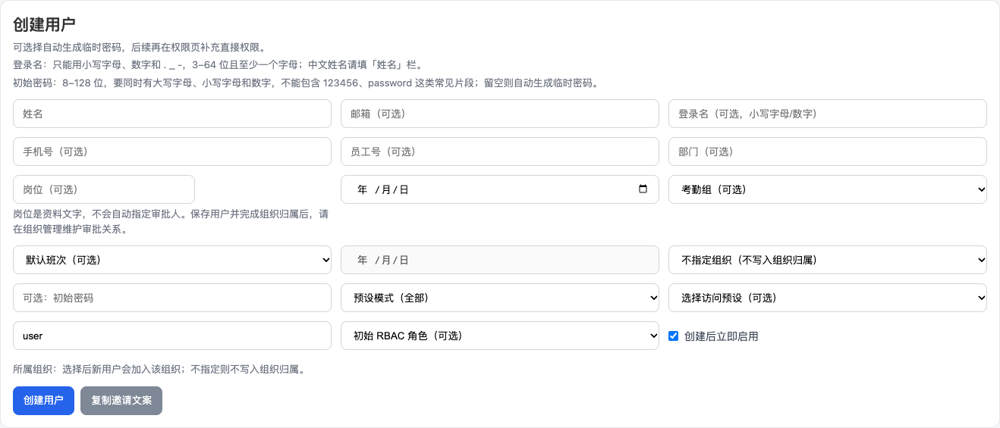
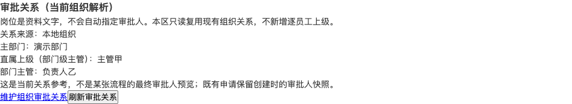
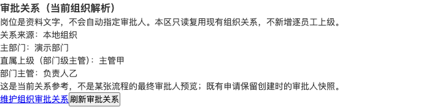
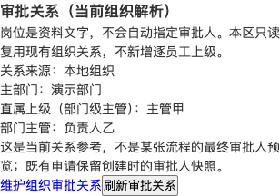

# User-management approval relationship summary — verification

Draft/HOLD. Exact R77 target build.commit is pending. This is a separate source input for the manager/head test package, not an installable R77 image.

## Behavior and gates

| Gate | Evidence | Boundary |
| --- | --- | --- |
| Existing user-admin admit set | Actual source-extracted gate controls: admin200, wildcard403, absent subject401; removing injected gate produces matching red | Mock transaction/resolver, not JWT/DB authorization |
| Read-only consistent snapshot | READ ONLY before reads; matching removal red | Existing resolver/source policy reused, no org/provider override |
| Exact DTO and refusal states | Initial backend8 passed; affected2 auth controls and1 denial passed in later phases | Not a fresh whole10 run |
| UI source/error/stale fencing | Initial frontend16 passed; affected known409/unknown4092 passed after fixes | Not a fresh whole18 run |
| Entry/browser | Actual built SPA at1366/768/390; position help, distinct manager/head, maintenance href and409 clears names | Synthetic API/auth fixtures, not real JWT/DB or R77 |
| Browser harness | Three scenarios passed before attempt2 postcheck failure; only startup rerun after adding existing startup GET and no-data method-probe fixtures | No business scenario rerun; startup0 unknown/business writes/page/console errors |
| Matching negatives | Readonly/admin/late-subject/principal guards; final injected existing-user-admin gate | Each actual named red, exact restoration |
| Quality | New5-source explicit eslint0; backend type-check0; web build0; validate:all0 after fixes | Existing whole-file lint not represented as clean |
| Independent source review | Both original P2 reproduced and fixed; final bounded review0 remaining P1/P2 | Source review is not execution |
| CI wiring | Frontend spec in approval domain guard and required web runner/token manifest | Current PR exact-head CI remains separate |

Commands: focused Vitest JSON phases with actual assertion statuses; pnpm exec eslint --no-ignore with explicit parser options for the five new source/test files; pnpm --filter @metasheet/core-backend type-check; pnpm --filter @metasheet/web build; pnpm validate:all. Filtered tests are excluded from passed counts. Earlier failed fixtures/harness attempts remain in remote evidence.

Existing manager/head behavior comes from independent Draft #6589 and #6592; their unchanged passed suites were not repeated. This change writes no relationships, adds no per-employee manager rule, interprets no position/title as a role, changes no source policy and adds no permissions/schema/flags.

## Synthetic screenshots

Rollback for this slice: remove this source patch/rebuild; no migration or relationship data write. The separate head migration in #6589 has its own data-preserving rollback prerequisites. No merge/deploy/R71/tag/release/config/provider write authorized.
